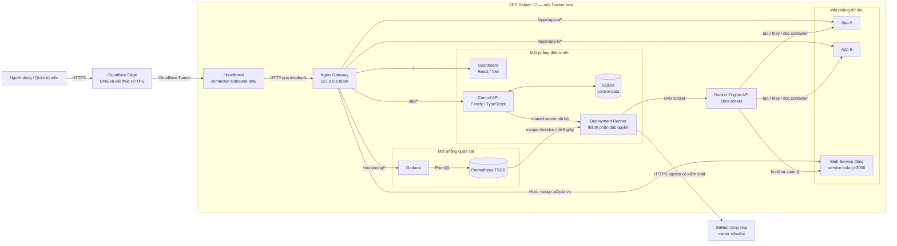
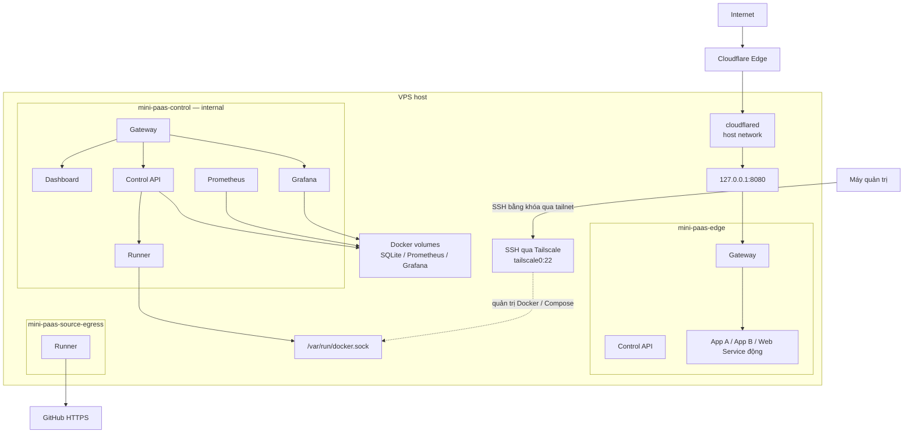
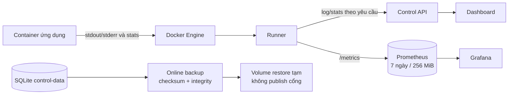

# Kiến trúc tổng thể cuối — Mini PaaS một máy

> Phiên bản runtime: `v1.0.0-rc.2` — mã runtime `2ce0e1c` đã được hồi quy trên VPS Debian 12 ngày 17/10/2026. RC2 chuẩn hóa tổ chức module nhưng không thay đổi endpoint, schema SQLite, mạng hoặc phạm vi chức năng của RC1. Đây không phải kiến trúc PaaS thương mại hoặc hệ thống nhiều máy.

## 1. Mục tiêu và phạm vi

Mini PaaS cung cấp một quy trình thống nhất để quản trị viên đăng ký Web Service từ repository GitHub công khai thuộc owner tin cậy, build Docker image, chạy container, cấp URL, điều khiển vòng đời, quản lý biến môi trường, xem log/tài nguyên và rollback trên một Docker host.

Phạm vi cuối gồm:

- Control Center tại `https://paas.ai2p.id.vn`.
- App A/App B cố định để kiểm thử hồi quy.
- Web Service động có image, container và hostname `https://<slug>.ai2p.id.vn` riêng.
- Triển khai thủ công commit mới nhất của `main` hoặc một SHA đầy đủ; không có webhook tự deploy.
- Prometheus/Grafana, backup/restore SQLite và release/rollback theo image ID cục bộ.
- Một VPS, một replica mỗi ứng dụng; không tuyên bố high availability hoặc SLA.

## 2. Sơ đồ thành phần tổng thể



### Phân chia trách nhiệm

| Mặt phẳng | Thành phần | Trách nhiệm |
|---|---|---|
| Truy cập | Cloudflare Edge, `cloudflared`, Gateway | DNS/TLS, Tunnel outbound-only và điểm vào HTTP duy nhất |
| Điều khiển | Dashboard, Control API, SQLite, Runner | Xác thực, metadata, điều phối deployment và thao tác vòng đời |
| Dữ liệu | App A, App B, Web Service động | Phục vụ request ứng dụng; không publish cổng host |
| Quan sát | Runner exporter, Prometheus, Grafana | Log/stats tức thời, chuỗi thời gian CPU/RAM/health và đồ thị |
| Khôi phục | Volume `control-data`, script backup/restore | Snapshot SQLite nhất quán và diễn tập phục hồi trên volume tạm |

Runner là thành phần duy nhất có Docker socket. Việc đặt Runner trong mặt phẳng điều khiển không làm quyền này trở nên an toàn tuyệt đối: nếu Runner bị chiếm quyền, toàn bộ Docker host có thể bị ảnh hưởng.

### Tổ chức module mã nguồn

Việc chia module bám theo trách nhiệm kỹ thuật, không tạo thêm service hoặc thay đổi luồng mạng lúc chạy:

```text
Dashboard
  App.tsx                 ghép layout và trạng thái dùng chung
  app/routing.tsx         ánh xạ URL sang màn hình
  features/*              thành phần theo ứng dụng, deployment, env, log, audit
  shared/*                định dạng và nhãn dùng lại

Control API
  server.ts               khởi tạo Fastify và đăng ký route
  routes/*                kiểm tra HTTP và gọi nghiệp vụ theo từng miền
  database.ts             giao diện dữ liệu ổn định cho các route
  database/types.ts       kiểu bản ghi
  database/migrations.ts  schema SQLite v1–v6 và transaction migration
  database/mappers.ts     chuyển tên cột SQLite sang đối tượng nghiệp vụ

Deployment Runner
  server.mjs              API nội bộ và xác thực shared secret
  runtime.mjs             điều phối build, deploy, rollback và vòng đời
  runtime-state.mjs       trạng thái công khai và biến môi trường container
  container-policy.mjs    chính sách giới hạn/quyền áp dụng đồng nhất
  docker.mjs              adapter Docker Engine API
```

`ControlDatabase` vẫn là điểm vào duy nhất của tầng dữ liệu để các route không phụ thuộc trực tiếp câu lệnh SQL. Tương tự, Control API chỉ gọi Runner qua API nội bộ; Dashboard không gọi Docker hoặc Runner trực tiếp. Tái cấu trúc này thay đổi cách tổ chức mã nguồn, không thay đổi endpoint, schema SQLite, mạng Compose hay URL công khai.

## 3. Sơ đồ mạng và ranh giới tin cậy



Các cặp `Gateway`, `Control API` và `Runner` xuất hiện ở nhiều vùng trong sơ đồ để biểu diễn một container tham gia nhiều mạng, không phải các bản sao độc lập.

| Thành phần | `edge` | `control` | `source-egress` | Cổng host | Docker socket |
|---|---:|---:|---:|---:|---:|
| Gateway | Có | Có | Không | `127.0.0.1:8080` | Không |
| Dashboard | Không | Có | Không | Không | Không |
| Control API | Có | Có | Không | Không | Không |
| Runner | Không | Có | Có | Không | Có |
| Prometheus/Grafana | Không | Có | Không | Không | Không |
| App A/App B/Web Service | Có | Không | Không | Không | Không |

Mạng `control` dùng `internal: true`. Runner chỉ có đường ra GitHub nhờ `source-egress`; không service nào trên mạng này publish cổng. Cloudflare Tunnel chuyển request vào Gateway qua loopback, không cần mở Docker API, Control API hoặc cổng ứng dụng ra Internet.

## 4. Luồng Git → build → image → deploy → route

```mermaid
sequenceDiagram
    actor Admin as Quản trị viên
    participant UI as Dashboard
    participant API as Control API
    participant DB as SQLite
    participant Runner as Deployment Runner
    participant Git as GitHub
    participant Docker as Docker Engine
    participant App as Container ứng dụng
    participant Gateway as Nginx Gateway

    Admin->>UI: Chọn Web Service và commit mới nhất hoặc SHA
    UI->>API: Gửi yêu cầu deployment có session
    API->>API: Kiểm tra origin, schema, app và tác vụ đang chạy
    API->>Runner: Phân giải main khi chọn commit mới nhất
    Runner->>Git: Đọc ref main
    Git-->>Runner: SHA 40 ký tự
    API->>DB: Lưu deployment queued và audit
    API-->>UI: HTTP 202
    API->>Runner: Deploy repository/context/SHA đã kiểm tra
    Runner->>Git: Tải archive cố định, tối đa 16 MiB
    Git-->>Runner: Snapshot source
    Runner->>Docker: Build image git-&lt;12 ký tự&gt;
    Docker-->>Runner: Image ID và build log
    Runner->>Docker: Tạo container mới với giới hạn an toàn
    Docker-->>Runner: Container chạy
    Runner->>App: Chờ /health đạt
    App-->>Runner: HTTP 200
    Runner->>Docker: Loại container cũ sau khi bản mới khỏe
    Runner-->>API: Commit, image ID, trạng thái và log
    API->>DB: Lưu deployment/release/audit
    UI->>API: Poll lịch sử deployment
    Admin->>Gateway: Mở https://&lt;slug&gt;.ai2p.id.vn
    Gateway->>App: Route theo hostname qua Docker DNS
    App-->>Admin: Nội dung và phiên bản mới
```

Nếu build hoặc health thất bại, Runner đánh dấu deployment thất bại và cố gắng phục hồi container cũ. Đây là cơ chế phục hồi trên một host, không phải zero-downtime deployment. Rollback chủ động cũng phụ thuộc image ID còn tồn tại trong cache của chính Docker host.

## 5. Luồng quan sát và lưu trữ



- SQLite giữ user/session hash, application, operation, deployment, release, audit và biến môi trường đã mã hóa.
- Prometheus giữ chuỗi thời gian; snapshot stats không được ghi vào SQLite.
- Grafana được provisioning từ Git; volume chỉ giữ metadata vận hành.
- Backup không chứa `.env` hoặc khóa mã hóa. Khôi phục thử nghiệm chỉ dùng volume có tiền tố an toàn và không ghi đè stack live.

## 6. Ranh giới quyền và biện pháp an toàn

| Chủ thể/thành phần | Được phép | Không được phép hoặc giới hạn |
|---|---|---|
| Người dùng chưa đăng nhập | Mở trang đăng nhập và ứng dụng công khai | API quản trị trả 401 |
| Quản trị viên Mini PaaS | Quản lý app qua Dashboard/API sau đăng nhập | Không nhận shell, host port, volume, capability hay network tùy ý |
| Control API | Lưu dữ liệu, xác thực, điều phối Runner | Không gắn Docker socket và không chạy shell |
| Runner | Quản lý container có nhãn/allowlist, build repository tin cậy | Quyền rất cao; không phải sandbox cho mã tùy ý |
| Web Service | Phục vụ cổng 3000 trong mạng `edge` | Không publish host port; root filesystem chỉ đọc, drop capability, giới hạn CPU/RAM/PID |
| `cloudflared` | Kết nối outbound tới Cloudflare và origin loopback | Token nằm ngoài Git; không chuyển tiếp Docker/API nội bộ trực tiếp |
| Người vận hành VPS | SSH bằng khóa qua Tailscale, quản lý Docker/Compose | Thành viên nhóm `docker` gần tương đương root |

Secret không được commit. `.env`, khóa mã hóa, Runner secret và token Tunnel nằm ngoài repository với quyền file hạn chế. Mã hóa SQLite và che secret trên API không ngăn người có quyền host/Docker đọc `Config.Env`; báo cáo phải giữ giới hạn này.

## 7. Liên kết yêu cầu, triển khai và kiểm thử

| Nhóm yêu cầu | Thành phần chính | Kiểm thử/bằng chứng |
|---|---|---|
| Định tuyến và hai app mẫu | Gateway, App A/B, mạng `edge` | T02, smoke 9/9 |
| Vòng đời/cập nhật | API, Runner, Docker Engine | T03, T04 |
| Log và tài nguyên | Runner, API, Dashboard | T05 |
| Chuỗi thời gian/đồ thị | Runner exporter, Prometheus, Grafana | T05, T06 |
| Xác thực và phân quyền | Dashboard, API, session, allowlist | T07 |
| Git → build → deploy | API, Runner, GitHub, Docker | `P1-GIT-LATEST-01` |
| Biến môi trường | API, SQLite mã hóa, Runner | `P1-ENV-01` |
| Release/rollback | SQLite release, image ID cục bộ, Runner | `P2-ROLLBACK-01` |
| URL HTTPS riêng | Cloudflare wildcard, Tunnel, Gateway host routing | `VPS-PUBLIC-01` |
| Backup/restore | SQLite online backup, volume tạm | T08 |

Ma trận kết quả chính thức nằm tại [`docs/test-plan/BANG_KIEM_THU_T01_T08.md`](../test-plan/BANG_KIEM_THU_T01_T08.md). Bảng địa chỉ/cổng/quyền VPS nằm tại [`BANG_TAI_NGUYEN_IP_QUYEN_VPS.md`](BANG_TAI_NGUYEN_IP_QUYEN_VPS.md).

## 8. Điểm lỗi đơn và giới hạn cuối

- VPS, Docker Engine, Gateway, Control API, Runner và SQLite đều là điểm lỗi đơn.
- Mỗi ứng dụng chỉ có một replica; cập nhật hoặc thay biến môi trường có thể gây gián đoạn ngắn.
- Không có registry digest, image signing, SBOM hoặc bản sao image ngoài host.
- Chưa có webhook, repository riêng tư, GitHub App, autoscaling, load balancing hoặc database hosting.
- Prometheus/Grafana cùng host nên không quan sát được khi toàn bộ VPS mất kết nối.
- Cloudflare Tunnel cải thiện khả năng truy cập công khai nhưng không biến kiến trúc thành high availability.
- Nền tảng chỉ build mã nguồn thuộc owner allowlist; đây không phải môi trường đa thuê để chạy mã không tin cậy.

Các giới hạn này là ranh giới có chủ đích của Mini PaaS một máy và phải được trình bày trong báo cáo/video thay vì suy rộng thành năng lực của PaaS thương mại.
