

**HỌC VIỆN CÔNG NGHỆ BƯU CHÍNH VIỄN THÔNG**

**VIỆN KHOA HỌC KỸ THUẬT BƯU ĐIỆN**

---

# BÁO CÁO BÀI TẬP LỚN

**HỌC PHẦN NHẬP MÔN CÔNG NGHỆ NỀN TẢNG — RIPT1304-20261-01**

## NGHIÊN CỨU, THIẾT KẾ VÀ XÂY DỰNG NỀN TẢNG TRIỂN KHAI, QUẢN LÝ ỨNG DỤNG WEB TỰ ĐỘNG TRÊN HẠ TẦNG CONTAINER

| Sinh viên thực hiện | Mã sinh viên |
|---|---|
| Đỗ Sỹ Việt | B24DCCC287 |
| Trần Hải Minh | B24DCCC206 |
| Lê Thị Thảo | B24DCCC253 |
| Mai Đức Duy | B24DCCC092 |

**Giảng viên: ThS. Nguyễn Xuân Dũng**

**Hà Nội – 2026**

---

# MỤC LỤC

- [LỜI CẢM ƠN](#lời-cảm-ơn)
- [DANH MỤC TỪ VIẾT TẮT](#danh-mục-từ-viết-tắt)
- [CHƯƠNG 1. TỔNG QUAN ĐỀ TÀI](#chương-1-tổng-quan-đề-tài)
  - [1.1. Bối cảnh và lý do chọn đề tài](#11-bối-cảnh-và-lý-do-chọn-đề-tài)
  - [1.2. Mục tiêu, phạm vi và phương pháp](#12-mục-tiêu-phạm-vi-và-phương-pháp)
- [CHƯƠNG 2. CƠ SỞ LÝ THUYẾT](#chương-2-cơ-sở-lý-thuyết)
  - [2.1. Container, image và Docker Compose](#21-container-image-và-docker-compose)
  - [2.2. Mạng, DNS, HTTP và reverse proxy](#22-mạng-dns-http-và-reverse-proxy)
  - [2.3. CI/CD, giám sát và kiểm thử tải](#23-cicd-giám-sát-và-kiểm-thử-tải)
- [CHƯƠNG 3. PHÂN TÍCH YÊU CẦU VÀ THIẾT KẾ](#chương-3-phân-tích-yêu-cầu-và-thiết-kế)
  - [3.1. Yêu cầu chức năng và phi chức năng](#31-yêu-cầu-chức-năng-và-phi-chức-năng)
  - [3.2. Kiến trúc tổng thể và ranh giới quyền](#32-kiến-trúc-tổng-thể-và-ranh-giới-quyền)
  - [3.3. Dữ liệu và các luồng chính](#33-dữ-liệu-và-các-luồng-chính)
- [CHƯƠNG 4. TRIỂN KHAI HỆ THỐNG](#chương-4-triển-khai-hệ-thống)
  - [4.1. Môi trường và cấu hình triển khai](#41-môi-trường-và-cấu-hình-triển-khai)
  - [4.2. Các thành phần đã xây dựng](#42-các-thành-phần-đã-xây-dựng)
  - [4.3. Triển khai công khai và sao lưu](#43-triển-khai-công-khai-và-sao-lưu)
  - [4.4. Làm mới giao diện quản trị và tính năng bổ sung (tháng 11/2026)](#44-làm-mới-giao-diện-quản-trị-và-tính-năng-bổ-sung-tháng-112026)
- [CHƯƠNG 5. KIỂM THỬ VÀ ĐÁNH GIÁ](#chương-5-kiểm-thử-và-đánh-giá)
  - [5.1. Chiến lược và kết quả T01–T08](#51-chiến-lược-và-kết-quả-t01t08)
  - [5.2. Kết quả kiểm thử tải](#52-kết-quả-kiểm-thử-tải)
  - [5.3. Đánh giá kết quả và giới hạn](#53-đánh-giá-kết-quả-và-giới-hạn)
  - [5.4. Kiểm thử Dashboard sau đợt làm mới giao diện](#54-kiểm-thử-dashboard-sau-đợt-làm-mới-giao-diện)
- [CHƯƠNG 6. KẾT LUẬN VÀ HƯỚNG PHÁT TRIỂN](#chương-6-kết-luận-và-hướng-phát-triển)
  - [6.1. Kết luận](#61-kết-luận)
  - [6.2. Hướng phát triển](#62-hướng-phát-triển)
- [TÀI LIỆU THAM KHẢO](#tài-liệu-tham-khảo)
- [PHỤ LỤC](#phụ-lục)
  - [Phụ lục A. Lệnh dựng và kiểm thử chính](#phụ-lục-a-lệnh-dựng-và-kiểm-thử-chính)
  - [Phụ lục B. Sử dụng AI và trách nhiệm của sinh viên](#phụ-lục-b-sử-dụng-ai-và-trách-nhiệm-của-sinh-viên)
  - [Phụ lục C. Đóng góp kỹ thuật của từng thành viên](#phụ-lục-c-đóng-góp-kỹ-thuật-của-từng-thành-viên)

# LỜI CẢM ƠN

Trong quá trình thực hiện bài tập lớn “Nghiên cứu, thiết kế và xây dựng nền tảng triển khai, quản lý ứng dụng Web tự động trên hạ tầng Container”, nhóm đã nhận được sự hướng dẫn và những góp ý thiết thực từ giảng viên phụ trách học phần. Những định hướng đó giúp nhóm lựa chọn phạm vi phù hợp, chú trọng vào kiến thức nền tảng về hệ điều hành, mạng, máy chủ, container, bảo mật và giám sát thay vì chỉ xây dựng một giao diện Web.

Nhóm xin trân trọng cảm ơn ThS. Nguyễn Xuân Dũng đã hướng dẫn nội dung học phần Nhập môn công nghệ nền tảng, tạo điều kiện để nhóm tiếp cận bài toán triển khai ứng dụng theo hướng thực hành và kiểm chứng bằng sản phẩm. Nhóm cũng cảm ơn Học viện Công nghệ Bưu chính Viễn thông và Viện Khoa học Kỹ thuật Bưu điện đã cung cấp môi trường học tập, tài liệu và cơ hội để sinh viên rèn luyện khả năng nghiên cứu, thiết kế và vận hành hệ thống.

Trong quá trình phát triển, nhóm sử dụng tài liệu chính thức của các dự án mã nguồn mở và công cụ hỗ trợ trí tuệ nhân tạo để phân tích, tạo bản nháp và rà soát. Mọi quyết định về phạm vi, cấu hình, mã nguồn, số liệu và kết luận trong báo cáo đều được nhóm xem xét, chỉnh sửa và chạy lại trên môi trường được phép. Do thời gian và tài nguyên có hạn, sản phẩm chắc chắn vẫn còn thiếu sót; nhóm mong nhận được ý kiến góp ý để tiếp tục hoàn thiện.

# DANH MỤC TỪ VIẾT TẮT

| **Từ viết tắt** | **Tiếng Anh** | **Giải thích sử dụng trong báo cáo** |
| --- | --- | --- |
| API | Application Programming Interface | Giao diện lập trình giữa Dashboard, Control API và Runner |
| CI/CD | Continuous Integration / Continuous Delivery | Tích hợp liên tục và quy trình phát hành/triển khai |
| CPU | Central Processing Unit | Tài nguyên xử lý của máy chủ hoặc container |
| DNS | Domain Name System | Hệ thống phân giải tên miền |
| HTTP/HTTPS | Hypertext Transfer Protocol / Secure | Giao thức truy cập Web; HTTPS có mã hóa TLS |
| MVP | Minimum Viable Product | Sản phẩm khả dụng tối thiểu |
| PaaS | Platform as a Service | Nền tảng cung cấp môi trường triển khai và vận hành ứng dụng |
| RAM | Random Access Memory | Bộ nhớ làm việc của hệ thống |
| SLA | Service Level Agreement | Cam kết mức dịch vụ; sản phẩm này không tuyên bố SLA |
| VPS | Virtual Private Server | Máy chủ ảo dùng làm môi trường nghiệm thu |

# CHƯƠNG 1. TỔNG QUAN ĐỀ TÀI

## 1.1. Bối cảnh và lý do chọn đề tài

Ứng dụng Web hiện đại không chỉ cần được lập trình đúng mà còn phải được đóng gói, triển khai, định tuyến, giám sát và khôi phục theo một quy trình có thể lặp lại. Nếu thực hiện thủ công, người vận hành phải tự cài môi trường, mở cổng, sao chép mã nguồn, khởi động tiến trình và xử lý sự khác biệt giữa các máy. Bài toán này liên quan trực tiếp đến hệ điều hành, mạng máy tính, quản lý tiến trình, tài nguyên phần cứng và an toàn hệ thống. Vì vậy, nhóm lựa chọn Mini PaaS như một mô hình thực hành kết nối các kiến thức nền tảng thành một quy trình hoàn chỉnh.

PaaS là mô hình cung cấp nền tảng để triển khai và vận hành ứng dụng mà người dùng không phải trực tiếp quản lý toàn bộ hạ tầng bên dưới. Sản phẩm của nhóm không nhằm tái tạo quy mô hoặc độ sẵn sàng của các dịch vụ thương mại như Render, Vercel hay Netlify. Mục tiêu phù hợp với học phần là xây dựng một mô hình một máy chủ có thể nhận mã nguồn Git tin cậy, build Docker image, tạo container, cấp địa chỉ truy cập, điều khiển vòng đời, xem log và tài nguyên, đồng thời lưu bằng chứng kiểm thử.

Giá trị của đề tài nằm ở chuỗi liên kết từ mã nguồn đến dịch vụ đang chạy. Dashboard chỉ là điểm điều khiển; phía sau còn có API, thành phần đặc quyền điều khiển Docker, mạng nội bộ, reverse proxy, cơ sở dữ liệu, hệ thống metric và công cụ kiểm thử tải. Cách tiếp cận này giúp nhóm phân biệt rõ control plane là nơi xử lý quyết định quản trị và data plane là nơi tiếp nhận lưu lượng của ứng dụng. Đây cũng là cơ sở để phân tích rủi ro của Docker socket, điểm lỗi đơn và giới hạn của mô hình một host.

## 1.2. Mục tiêu, phạm vi và phương pháp

Mục tiêu tổng quát của đề tài là nghiên cứu, thiết kế và xây dựng một nền tảng triển khai, quản lý ứng dụng Web tự động ở quy mô thực hành. Hệ thống phải chạy được trên một máy phát triển hoặc VPS, có thể dựng lại bằng Docker Compose và có đủ bằng chứng để người khác kiểm tra các chức năng cốt lõi.

- Triển khai tối thiểu hai ứng dụng Web mẫu qua một Gateway duy nhất, có health check và thông tin phiên bản.

- Cho phép quản trị viên đăng nhập, xem trạng thái, dừng, khởi động, khởi động lại, cập nhật phiên bản và xem log/tài nguyên.

- Nhận repository GitHub công khai thuộc owner tin cậy, build commit mới nhất hoặc commit cụ thể thành image và tạo Web Service có hostname riêng.

- Theo dõi CPU, RAM, PID, lưu lượng mạng và chuỗi thời gian bằng Prometheus/Grafana; thử tải ở các mức cố định bằng k6.

- Lưu lịch sử deployment/release, hỗ trợ rollback theo image ID cục bộ, mã hóa biến môi trường và thử sao lưu/khôi phục SQLite.

Phạm vi được giới hạn ở một quản trị viên, một Docker host và repository đã cho phép. Hệ thống không hỗ trợ mã nguồn tùy ý từ Internet, repository riêng tư, nhiều tenant, nhiều replica, autoscaling hoặc high availability. Workflow GitHub Actions của repository chỉ thực hiện CI nội bộ; bản phát hành không tự triển khai khi push. Những giới hạn này được giữ rõ trong thiết kế và kết luận để tránh đánh đồng mô hình học tập với nền tảng thương mại.

Phương pháp thực hiện gồm khảo sát tài liệu chính thức, phân tích yêu cầu, thiết kế kiến trúc, triển khai tăng dần theo P0/P1/P2 và kiểm thử bằng các kịch bản T01–T08. Mỗi thay đổi quan trọng được chạy unit test, integration test hoặc smoke test; bằng chứng có thời gian, môi trường, lệnh, kết quả và checksum. Số liệu hiệu năng chỉ được sử dụng khi có dữ liệu gốc, đồng thời nêu rõ điều kiện nguồn phát tải chạy cùng VPS.

# CHƯƠNG 2. CƠ SỞ LÝ THUYẾT

## 2.1. Container, image và Docker Compose

Container là một tiến trình được cô lập tương đối bằng các cơ chế của hệ điều hành như namespace và cgroup. Khác với máy ảo đầy đủ, container dùng chung kernel của host nên thường nhẹ và khởi động nhanh hơn, nhưng mức cô lập không đồng nghĩa một lớp bảo vệ tuyệt đối. Docker image là mẫu chỉ đọc chứa tệp, thư viện và cấu hình cần thiết; container là một thể hiện đang chạy của image [1]. Khi container bị xóa, dữ liệu không nằm trong volume hoặc kho lưu trữ bền vững có thể mất.

Docker Engine dùng kiến trúc client–server. Docker daemon quản lý image, container, network và volume, còn client gửi yêu cầu qua API hoặc Unix socket [1]. Quyền truy cập Docker socket rất nhạy cảm vì có thể tạo container đặc quyền hoặc gắn filesystem host. Trong Mini PaaS, chỉ Deployment Runner được gắn socket; Dashboard và Control API không có quyền này. Đây là biện pháp giảm bề mặt tấn công, nhưng Runner vẫn phải được coi là thành phần có quyền gần tương đương quản trị host.

Docker Compose mô tả một ứng dụng nhiều container bằng cấu hình có phiên bản hóa, gồm service, image/build context, mạng, volume, health check và giới hạn tài nguyên [2]. Nhóm sử dụng Compose vì phù hợp quy mô một host và giúp dựng lại môi trường bằng cùng một tập lệnh. Kubernetes không được chọn vì sẽ làm tăng số thành phần, chi phí học tập và khó khăn vận hành mà chưa tạo thêm giá trị cần thiết cho mục tiêu một tháng.

## 2.2. Mạng, DNS, HTTP và reverse proxy

Trong mô hình Client–Server, trình duyệt gửi yêu cầu HTTP đến một địa chỉ IP và cổng. DNS ánh xạ tên miền dễ nhớ sang đích mạng; HTTPS bổ sung TLS để bảo vệ dữ liệu trên đường truyền. Reverse proxy đứng trước các ứng dụng, nhận yêu cầu từ client rồi chuyển tiếp đến upstream thích hợp. Nginx cung cấp chỉ thị proxy_pass và có thể giữ nguyên các header như Host hoặc địa chỉ nguồn theo cấu hình [3].

Mini PaaS sử dụng Nginx Gateway làm điểm vào duy nhất. App A và App B dùng đường dẫn /apps/app-a/ và /apps/app-b/; Web Service động dùng hostname dạng <slug>.ai2p.id.vn. Trong Docker network, Gateway định tuyến bằng tên service/alias thay vì ghi cứng IP vì IP container có thể thay đổi khi tái tạo. Mạng edge chứa Gateway và ứng dụng; mạng control chứa Dashboard, API, Runner, Prometheus và Grafana; source-egress chỉ dành cho Runner tải archive Git.

Trên VPS, Gateway chỉ bind 127.0.0.1:8080. Cloudflare Tunnel thiết lập kết nối đi ra từ connector đến Cloudflare và công bố hostname về origin nội bộ [4]. Vì VPS không có bằng chứng port forwarding 80/443 chiều vào, phương án Tunnel cho phép HTTPS công khai mà không đưa Docker API hoặc các cổng nội bộ ra Internet. Tuy nhiên, Tunnel không loại bỏ nhu cầu xác thực; Dashboard công khai vẫn phải dùng session, cookie Secure và kiểm tra Origin.

## 2.3. CI/CD, giám sát và kiểm thử tải

Tích hợp liên tục (CI) là quá trình tự động kiểm tra mã nguồn sau thay đổi. GitHub Actions tổ chức công việc thành workflow, job và step trên runner [5]. Trong dự án, workflow CI dùng quyền chỉ đọc, phiên bản Node cố định, action ghim bằng commit SHA, chạy build và regression rồi lưu image manifest. CI này phục vụ chất lượng mã nguồn; nó không tự triển khai bản mới lên VPS và không được mô tả là webhook deployment.

Prometheus thu thập metric bằng cách scrape endpoint HTTP và lưu dưới dạng chuỗi thời gian có timestamp cùng label [6]. Runner exporter chỉ xuất metric cho các ứng dụng trong catalog/allowlist. Grafana được provision datasource và dashboard từ tệp, giúp cấu hình có thể được lưu trong Git và dựng lại [7]. Dashboard vận hành cung cấp ảnh chụp tức thời, còn Prometheus/Grafana cung cấp xu hướng theo thời gian; hai cơ chế bổ sung cho nhau chứ không thay thế lẫn nhau.

Kiểm thử tải dùng k6 với executor constant-arrival-rate. Cơ chế open model khởi tạo iteration theo tốc độ đã định, tương đối độc lập với thời gian phản hồi của hệ thống [8]. Các chỉ số chính gồm request rate thực tế, thời gian phản hồi p95, tỷ lệ lỗi, tỷ lệ check thành công và dropped iterations. p95 là giá trị mà 95% số lần đo không vượt quá; đây là chỉ số phù hợp hơn trung bình khi cần quan sát phần đuôi của phân bố độ trễ.

Sao lưu SQLite sử dụng cơ chế online backup để tạo snapshot nhất quán khi cơ sở dữ liệu đang hoạt động [9]. Bài thử phục hồi không ghi đè stack thật: dữ liệu được restore vào volume tạm, kiểm tra đăng nhập và danh mục ứng dụng rồi dọn tài nguyên.

# CHƯƠNG 3. PHÂN TÍCH YÊU CẦU VÀ THIẾT KẾ

## 3.1. Yêu cầu chức năng và phi chức năng

Tác nhân chính là quản trị viên Mini PaaS. Người dùng Internet chỉ truy cập ứng dụng đã công bố và trang đăng nhập; họ không có quyền gọi API điều khiển. Các yêu cầu chức năng được chọn theo chuỗi vòng đời từ đăng ký source, build, triển khai, truy cập, quan sát, thao tác và khôi phục.

**Bảng 3.1. Yêu cầu chức năng chính**

| **Mã** | **Yêu cầu** | **Mức** |
| --- | --- | --- |
| FR01 | Hiển thị danh sách và trạng thái từng ứng dụng | Bắt buộc |
| FR02 | Định tuyến App A/App B và Web Service qua Gateway | Bắt buộc |
| FR03 | Xác thực quản trị và ghi audit | Bắt buộc |
| FR04 | Stop, start và restart ứng dụng | Bắt buộc |
| FR05 | Cập nhật phiên bản App A | Bắt buộc |
| FR06 | Quản lý operation bất đồng bộ và kết quả | Bắt buộc |
| FR07 | Xem log giới hạn theo ứng dụng | Bắt buộc |
| FR08 | Xem CPU, RAM, PID và lưu lượng mạng | Nên có |
| FR09 | Build/deploy latest hoặc SHA từ GitHub tin cậy | Bắt buộc |
| FR10 | Lưu chuỗi thời gian và hiển thị Grafana | Nên có |
| FR11 | Quản lý biến môi trường, che secret | Nên có |
| FR12 | Lịch sử release và rollback cục bộ | Nâng cao |
| FR13 | Cấp HTTPS công khai và hostname theo slug | Bắt buộc |

Yêu cầu phi chức năng gồm khả năng dựng lại, giới hạn tài nguyên, không công khai Docker socket, không lưu secret trong Git, phản hồi lỗi rõ ràng và có kiểm thử tự động. Hệ thống phải phân biệt trạng thái container, health HTTP, phiên bản mong muốn và phiên bản quan sát được. Mọi thao tác nhạy cảm cần xác thực; input phải qua schema và allowlist; log/metric phải giới hạn để tránh tiêu thụ tài nguyên không kiểm soát.

## 3.2. Kiến trúc tổng thể và ranh giới quyền

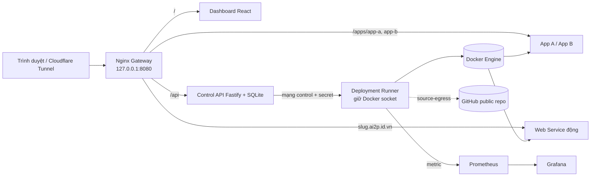

*Hình 3.1. Kiến trúc tổng thể Mini PaaS trên một máy chủ*

Gateway là điểm vào duy nhất của data plane. Dashboard là ứng dụng React tĩnh; Control API dùng Fastify để xử lý xác thực, dữ liệu và điều phối; Deployment Runner là service duy nhất điều khiển Docker. SQLite lưu tài khoản, session, application, operation, deployment, release, biến môi trường và audit. Prometheus scrape metric từ Runner, còn Grafana truy vấn Prometheus và hiển thị dashboard được cấp sẵn.

Tách Control API khỏi Runner là quyết định bảo mật trọng tâm. API nhận dữ liệu từ trình duyệt nhưng không có Docker socket. Runner chỉ nhận yêu cầu từ mạng control kèm shared secret, kiểm tra lại catalog/allowlist và tự chọn container bằng nhãn; client không được truyền container ID hoặc lệnh shell. Nếu Runner bị chiếm quyền, Docker host vẫn có nguy cơ cao, vì vậy hệ thống chỉ build repository công khai thuộc owner tin cậy và không quảng bá như sandbox đa thuê.

Ứng dụng được chạy non-root, root filesystem chỉ đọc, bỏ Linux capability, bật no-new-privileges và giới hạn CPU/RAM/PID. Các biện pháp này giảm tác động của lỗi ứng dụng nhưng không thay thế sandbox mạnh hoặc máy ảo. Model một host còn có điểm lỗi đơn tại VPS, Gateway, Docker daemon và volume cục bộ; restart policy không được coi là high availability.

**Bảng 3.2. Bảng tài nguyên, mạng và quyền trên VPS**

| **Thành phần/chủ thể** | **Mạng hoặc cổng** | **Quyền chính** | **Giới hạn** |
| --- | --- | --- | --- |
| Gateway | edge + control; host 127.0.0.1:8080 | Reverse proxy duy nhất | Không có Docker socket |
| Dashboard | control; không publish | Giao diện quản trị | Chỉ gọi Control API |
| Control API | edge + control; không publish | Session, SQLite, operation | Không điều khiển Docker trực tiếp |
| Runner | control + source-egress | Build và quản lý container | Có Docker socket; rủi ro cao |
| App/Web Service | edge; không publish | Phục vụ HTTP cổng 3000 | Non-root, read-only, giới hạn tài nguyên |
| Prometheus/Grafana | control; qua Gateway | Lưu/hiển thị metric | Cùng host, không quan sát khi host hỏng |
| Quản trị Linux | SSH qua Tailscale | Compose và cấu hình VPS | Nhóm docker gần tương đương root |
| Internet chưa đăng nhập | HTTPS qua Cloudflare | Xem login và ứng dụng công khai | API quản trị trả 401 |

## 3.3. Dữ liệu và các luồng chính

SQLite được chọn vì mô hình chỉ có một quản trị viên và lưu lượng metadata nhỏ. Bảng users chứa salt và hash scrypt; sessions chỉ lưu hash token; applications lưu loại ứng dụng, repository, build context, hostname và phiên bản; operations/deployments lưu trạng thái queued, running, succeeded hoặc failed; releases lưu image reference và image ID; audit_events lưu tác nhân, hành động, kết quả, địa chỉ nguồn và thời gian. Metric dài hạn nằm trong Prometheus TSDB; riêng lịch sử CPU/RAM phục vụ biểu đồ Dashboard được lấy mẫu định kỳ vào bảng resource_samples (schema v7) và tự dọn mẫu cũ.

Khi đăng nhập, API đối chiếu mật khẩu bằng scrypt rồi phát token ngẫu nhiên qua cookie HttpOnly, SameSite=Strict; trên VPS cookie có cờ Secure. Các POST kiểm tra Origin khớp PUBLIC_ORIGIN. Mật khẩu, Runner shared secret, khóa mã hóa biến môi trường và Tunnel token được cung cấp qua môi trường/tệp ngoài Git. Giá trị secret ứng dụng được mã hóa AES-256-GCM trong SQLite và không trả lại Dashboard; người có quyền Docker host vẫn có thể đọc Config.Env nên đây chưa phải secret manager production.

Thao tác vòng đời được nhận bằng HTTP 202 và xử lý bất đồng bộ. Control API tạo operation queued, sau đó Runner kiểm tra allowlist và nhãn trước khi thao tác. Dashboard polling để cập nhật trạng thái. Khi update hoặc rollback, Runner tạo container mới, chờ health rồi mới xóa bản cũ; nếu thất bại, Runner cố gắng phục hồi. Do chỉ có một replica, vẫn có gián đoạn ngắn và không thể gọi là zero-downtime deployment.

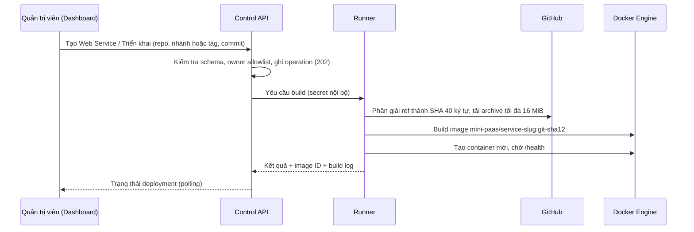

*Hình 3.2. Luồng triển khai Web Service từ repository GitHub*

Luồng Git chấp nhận URL HTTPS GitHub công khai, owner nằm trong TRUSTED_GITHUB_OWNERS, nhánh hoặc tag được chọn trong form (mặc định main) và Dockerfile trong build context tương đối. Runner phân giải HEAD thành SHA 40 ký tự hoặc kiểm tra SHA do quản trị viên nhập, tải archive từ URL cố định với giới hạn 16 MiB, build image git-<12 ký tự>, gắn label revision/source, tạo container và chờ health. Deployment lưu commit, image, image ID, build log, người yêu cầu và mốc thời gian. Webhook, repository riêng tư và hủy build chưa được hỗ trợ.

# CHƯƠNG 4. TRIỂN KHAI HỆ THỐNG

## 4.1. Môi trường và cấu hình triển khai

Môi trường phát triển ban đầu là macOS với Docker tương thích; môi trường nghiệm thu là VPS Debian 12 x86_64, 2 vCPU, khoảng 3,8 GiB RAM, SSD 40 GB và swap 2 GiB. Mã nguồn nằm trong repository GitHub; file .env không được commit. Lệnh make up kiểm tra cấu hình, build stack, chuẩn bị App A v2 và chờ toàn bộ service khỏe. Stack release candidate gồm tám service nền tảng/ứng dụng, ngoài ra có cloudflared chạy riêng trên VPS.

**Bảng 4.1. Phiên bản môi trường nghiệm thu**

| **Thành phần** | **Phiên bản** |
| --- | --- |
| Hệ điều hành | Debian GNU/Linux 12, kernel 6.1.0-53-cloud-amd64 |
| Docker Engine / Compose | 29.9.0 / 5.6.0 |
| Node.js | 24.21.0 |
| Nginx | 1.28.3 |
| Prometheus / Grafana | 3.14.0 / 13.2.2 |
| k6 / cloudflared | 2.3.0 / 2026.10.0, image ghim digest |
| Dashboard | 0.2.0, React 19.3.0, Vite 8.3.4, TypeScript 7.0.2 |
| Control API / Runner | 0.2.0, Fastify 5.12.5, TypeScript 7.0.2 |

Ba Docker network được sử dụng: edge cho lưu lượng ứng dụng, control cho giao tiếp quản trị nội bộ và source-egress cho Runner tải mã nguồn. Chỉ Gateway publish host port 127.0.0.1:8080. Volume control-data, prometheus-data và grafana-data giữ trạng thái. Health check được khai báo cho service quan trọng; Compose phụ thuộc health thay vì chỉ phụ thuộc trạng thái process đã start.

## 4.2. Các thành phần đã xây dựng

Dashboard được viết bằng React, Vite và TypeScript. Thông tin được tách thành tổng quan toàn hệ thống, danh sách ứng dụng và trang chi tiết theo từng ứng dụng. Luồng tạo Web Service nằm tại /applications/new, tách khỏi danh sách. Mỗi ứng dụng có trang tổng quan, triển khai, biến môi trường, log và tài nguyên. Giao diện gọi API qua Gateway và sử dụng polling định kỳ cho operation/deployment; phần làm mới giao diện tháng 11/2026 được mô tả tại mục 4.4.

Control API dùng Fastify và JSON Schema để kiểm tra body, params và query. API quản lý login/logout, session, applications, operations, deployments, environment variables, releases và audit. Các tác vụ Docker được chuyển tới Runner qua mạng control. Database migration được thực hiện khi khởi động; schema hiện tại là v7 (thêm bảng resource_samples lưu lịch sử CPU/RAM). API kiểm tra health/version qua Gateway hoặc Docker DNS tùy loại ứng dụng.

Runner dùng Docker Engine API thay vì ghép lệnh shell từ input. Catalog cố định quản lý App A/B; danh mục Web Service động được đồng bộ từ Control API nhưng vẫn chịu owner allowlist, cổng 3000 và giới hạn tài nguyên cố định. Runner có endpoint nội bộ cho status, action, logs, stats, environment, source build, rollback và metric. Log chỉ đọc tối đa 50/100/200 dòng, dữ liệu thô tối đa 2 MiB và mỗi dòng tối đa 4.096 ký tự.

App A và App B là Web server Node.js tối giản, có /health, /version và log JSON. App A có v1.0.0 và v2.0.0 để kiểm chứng update/rollback; App B dùng cho định tuyến và vòng đời độc lập. Web Service động không khai báo sẵn trong Compose: mỗi service được tạo image mini-paas/service-<slug>, container có alias service-<slug> và hostname riêng.

Prometheus scrape Runner mỗi 5 giây, retention tối đa 7 ngày hoặc 256 MiB và nạp ba rule: ứng dụng không khỏe, tỷ lệ RAM cao và lỗi đọc Docker stats. Grafana tắt truy cập ẩn danh, provision datasource/dashboard sáu vùng. Chưa có Alertmanager hoặc kênh gửi thông báo, vì vậy rule hiện chỉ hỗ trợ quan sát và minh chứng.

## 4.3. Triển khai công khai và sao lưu

Tên miền ai2p.id.vn dùng Cloudflare làm DNS có thẩm quyền. Tunnel mini-paas-vps công bố paas.ai2p.id.vn và wildcard *.ai2p.id.vn, cùng chuyển tới http://127.0.0.1:8080. Gateway đọc Host để tách Control Center và Web Service. PUBLIC_ORIGIN được đặt https://paas.ai2p.id.vn, SESSION_COOKIE_SECURE=true và SERVICE_BASE_DOMAIN=ai2p.id.vn. Hai sản phẩm độc lập vps-demo và demo đã được truy cập công khai qua HTTPS.

Connector cloudflared được ghim phiên bản/image digest, chạy restart unless-stopped, host network, root filesystem read-only, UID/GID 1000:1000, bỏ capability và bật no-new-privileges. Token đặt ngoài repository trong tệp quyền 0600. UFW mặc định chặn inbound; SSH chỉ được phép qua interface Tailscale và đã tắt password/root login. Các cổng 80/443 được phép ở firewall nhưng không có dịch vụ host lắng nghe; kết nối trực tiếp chiều vào chưa được chứng minh.

Script backup dùng SQLite online backup, tạo summary và checksum. Script restore xác minh checksum/integrity trước khi ghi volume đích. Kịch bản T08 phục hồi vào volume tạm, chạy Control API tạm không publish port, đăng nhập và đọc đủ bốn ứng dụng, gọi App A qua Gateway, sau đó xác nhận stack tám service không thay đổi. Bản sao nhạy cảm được chuyển ra thư mục ngoài repository với quyền 0700/0600.

## 4.4. Làm mới giao diện quản trị và tính năng bổ sung (tháng 11/2026)

Sau bản RC2, Dashboard được thiết kế lại hoàn toàn và Control API/Runner được bổ sung ba tính năng nhỏ. Các thay đổi nằm trong ba commit trên nhánh `feature/web-glass-aurora-ui` (hợp nhất qua Pull Request #1): `2a10987` (giao diện), `f514974` (backend), `4722f89` (frontend tính năng mới).

**Giao diện.** Hệ thống token CSS (`tokens.css`) có hai chế độ sáng/tối chuyển bằng thuộc tính `data-theme`; thanh điều hướng xanh than thu gọn được; trên điện thoại thanh điều hướng dưới (BottomNav) thay cho sidebar. Biểu đồ dùng recharts, hiệu ứng chuyển trang dùng motion. Trang Dashboard được nạp lười (lazy) để giảm bundle ban đầu. Chính sách CSP `script-src 'self'; style-src 'self'` được giữ nguyên: script khởi tạo theme chuyển thành module và bỏ phần chèn `<style>` nội tuyến của thư viện hiệu ứng.

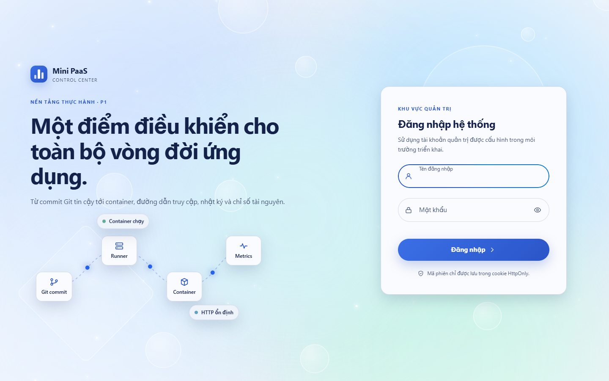

*Hình 4.1. Trang đăng nhập quản trị*

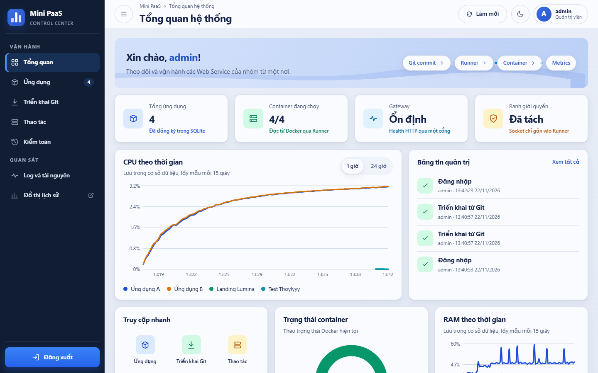

*Hình 4.2. Trang Tổng quan: KPI, biểu đồ đường CPU/RAM theo thời gian, trạng thái container*

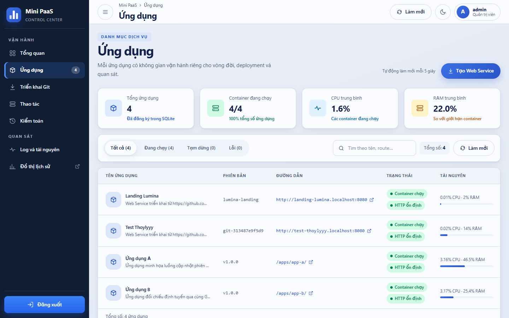

*Hình 4.3. Danh sách ứng dụng với bộ lọc trạng thái và ô tìm kiếm*

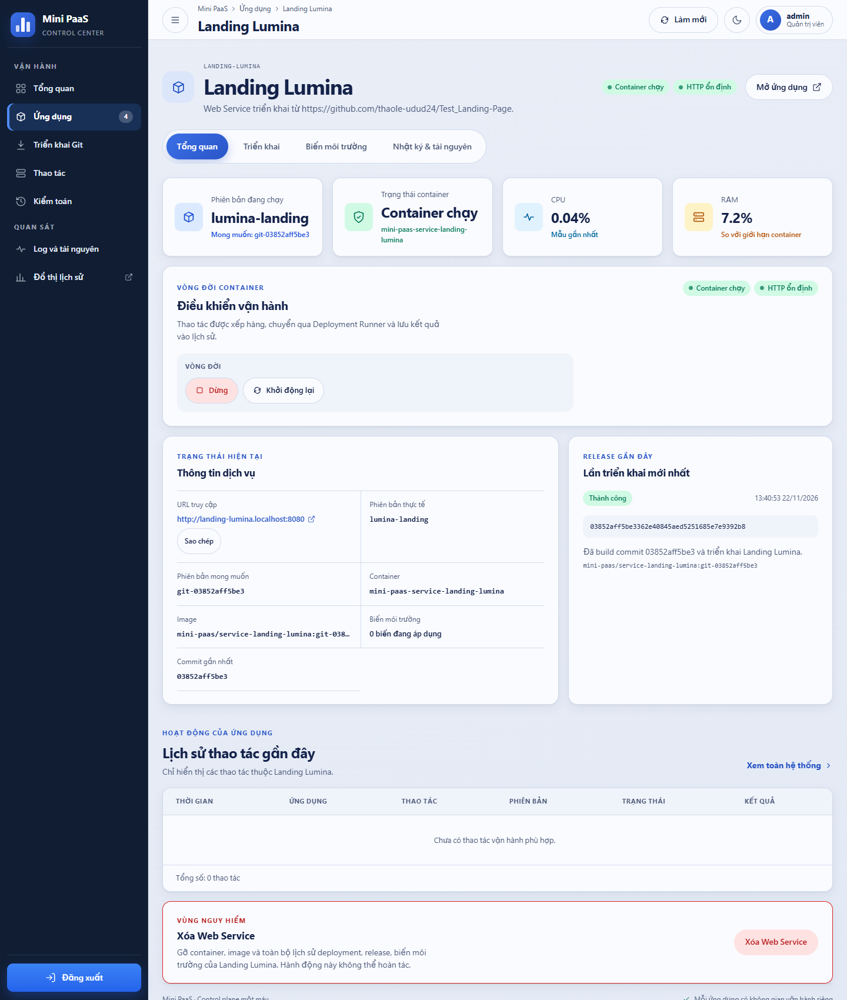

*Hình 4.4. Trang chi tiết một ứng dụng: thông tin, điều khiển vòng đời, deployment, xóa Web Service*

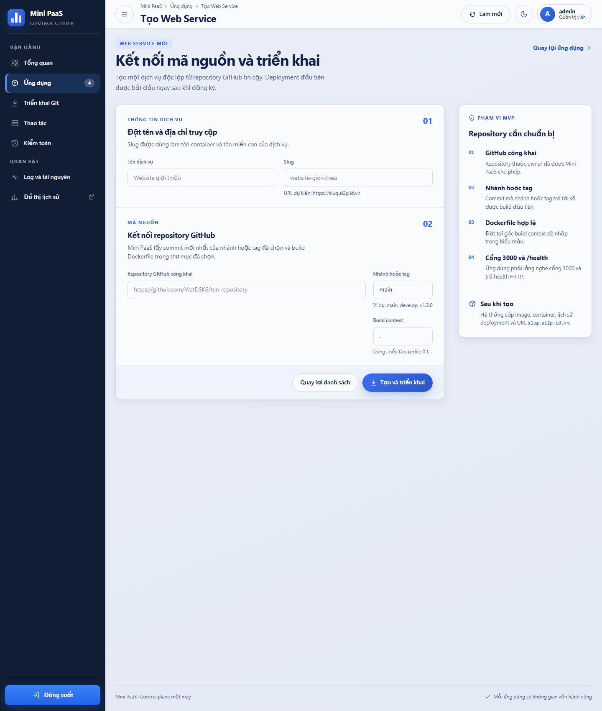

*Hình 4.5. Form tạo Web Service (repository GitHub, nhánh/tag, build context)*

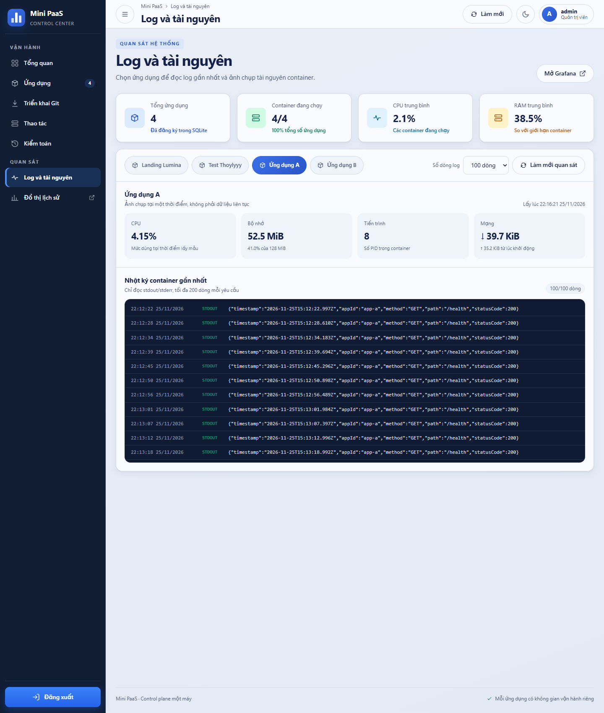

*Hình 4.6. Trang Log và tài nguyên*

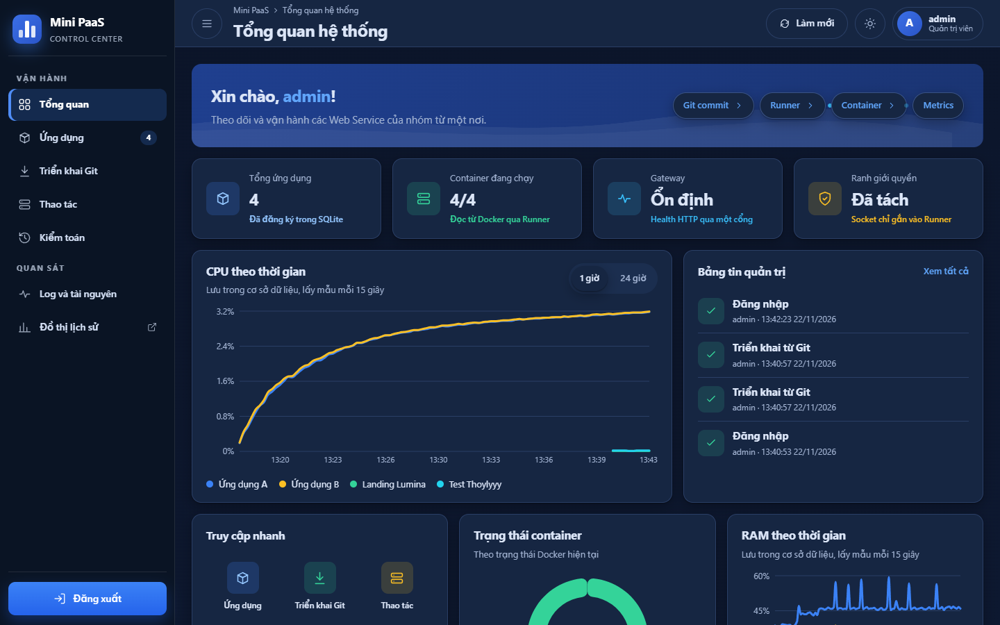

*Hình 4.7. Chế độ tối*

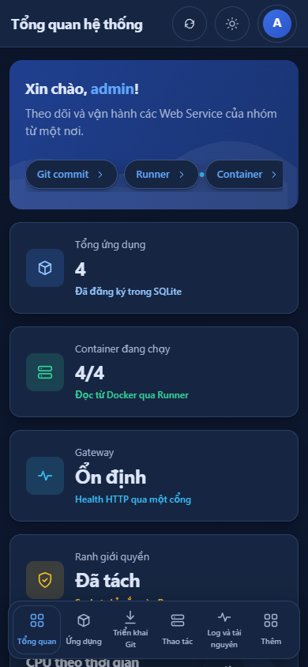

*Hình 4.8. Giao diện điện thoại 390×844*

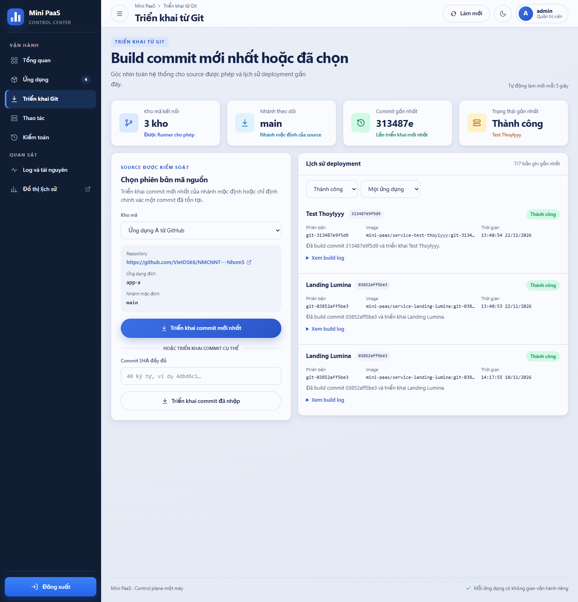

*Hình 4.9. Lọc lịch sử deployment theo kết quả và ứng dụng*

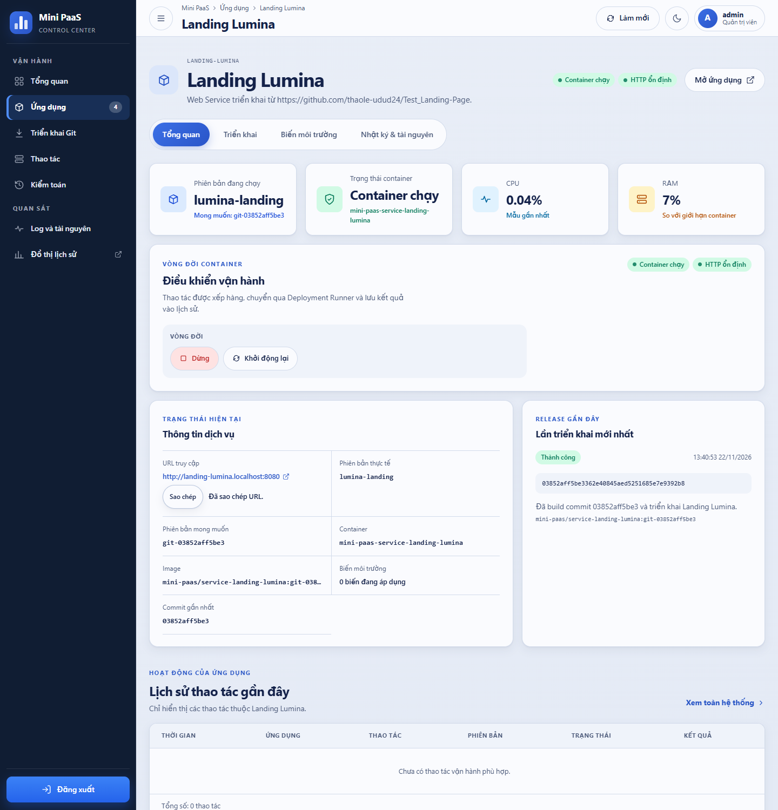

*Hình 4.10. Nút sao chép URL ứng dụng*

**Ba tính năng mới.**

| Tính năng | Cách thực hiện | Kiểm tra |
|---|---|---|
| Lịch sử CPU/RAM bền vững | `sampler.ts` lấy mẫu Runner định kỳ, ghi `resource_samples` (migration v7), `GET /api/v1/metrics/history`, tự dọn mẫu cũ; Dashboard vẽ biểu đồ đường và vẫn hiển thị sau khi tải lại trang | Control API test |
| Xóa Web Service | `DELETE` ở Control API gọi Runner xóa container, image tag `mini-paas/service-<slug>` và bản ghi; chặn khi đang có thao tác khác (`activeDeletions`); xác nhận hai bước trong `DeleteServicePanel` | Control API test, Runner test |
| Chọn nhánh/tag | `validateSourceRef` kiểm tra ref theo allowlist ký tự; phân giải bằng `commits/{ref}` với `Accept: application/vnd.github.sha` (tránh JSON 265 KB gây lỗi `source_metadata_invalid`) | Runner test |

**Lỗi đáng ghi nhận.** GitHub API trả kết quả cache `max-age=60`, nên deploy "latest" ngay sau khi push có thể lấy commit cũ; Runner thêm tham số `?cb=` để vô hiệu cache. Ngoài ra API không xác thực của GitHub chỉ cho 60 yêu cầu/giờ; khi vượt hạn mức, Runner trả `source_provider_rate_limited` và việc deploy phải chờ hạn mức được đặt lại (đã gặp trong lúc chụp ảnh cho báo cáo này).

**Kiểm chứng.** Với repository thật `Test_Thoylyyy` và `Test_Landing-Page`, luồng tạo service, build, chạy và mở theo hostname `<slug>.localhost:8080` hoạt động trên máy phát triển. Bố cục được rà trên nhiều kích thước màn hình mà không phát hiện tràn ngang. Các phép kiểm tra này chạy trên máy phát triển, không phải VPS, nên không thay thế bằng chứng nghiệm thu T01–T08.

# CHƯƠNG 5. KIỂM THỬ VÀ ĐÁNH GIÁ

## 5.1. Chiến lược và kết quả T01–T08

Kiểm thử được tổ chức theo tầng: unit test cho logic Runner/Control API, production build cho Dashboard, integration test cho luồng HTTP–Docker–SQLite, smoke test qua Gateway và bài thử riêng trên VPS. Mỗi kịch bản ghi đầu vào, thao tác, kết quả mong đợi, thực tế, trạng thái và đường dẫn evidence. Release candidate v1.0.0-rc.2 dùng commit runtime 2ce0e1c1dedf03f84cb77a426559706d4982f2d6; T06 giữ commit đo gốc 5cc99b1.

**Bảng 5.1. Tổng hợp kiểm thử T01–T08**

| **Mã** | **Mục tiêu và thao tác chính** | **Kết quả thực tế** | **Kết luận** |
| --- | --- | --- | --- |
| T01 | Dựng stack trên VPS, config, regression và smoke | 8 service khỏe; smoke 9/9; thiếu raw log riêng của lần dựng sạch | Đạt có lưu ý |
| T02 | Truy cập App A/B qua Gateway; kiểm tra host port | Route/health/version đúng; chỉ Gateway bind loopback | Đạt |
| T03 | Update App A v1 → v2 → v1; thử version cấm | Operation đúng; latest bị từ chối; trạng thái cuối v1 | Đạt |
| T04 | Stop/start/restart App B | Khi dừng Gateway 504; sau start/restart app khỏe | Đạt |
| T05 | Log/stats, Prometheus và Grafana | P0.2C 12 kiểm tra; observability 15 kiểm tra; metric hợp lệ | Đạt |
| T06 | Ba vòng 10/25/50 req/s, 60 giây/mức | 9/9 tổ hợp đạt; lỗi 0%; dropped 0 | Đạt |
| T07 | Session/origin/schema/Runner secret và socket boundary | 400/401/403 phù hợp; socket chỉ ở Runner | Đạt |
| T08 | Backup, checksum, restore volume tạm và API phục hồi | Integrity ok; 4 app; HTTP 200; stack live không đổi | Đạt |

Ngoài T01–T08, bộ hồi quy xác nhận deploy latest 15 kiểm tra, biến môi trường 21 kiểm tra, rollback 17 kiểm tra và HTTPS/wildcard public hoạt động. Sau đợt hoàn thiện tháng 11/2026, unit test đạt 33/33 ở Runner và 17/17 ở Control API; Dashboard đạt typecheck, 9/9 test logic lọc và production build (30/30 và 14/14 là kết quả của RC2). Kho evidence release đã quét secret, đối soát checksum và không chứa .env, token, cookie jar, private key hoặc database nhạy cảm.

## 5.2. Kết quả kiểm thử tải

T06 sử dụng k6 2.3.0 qua Gateway. Sau warm-up 5 req/s, mỗi vòng chạy lần lượt 10, 25 và 50 req/s trong 60 giây; ba vòng độc lập tạo chín tổ hợp. Threshold gồm p95 dưới 500 ms, lỗi dưới 1%, check trên 99% và dropped iterations bằng 0. Dữ liệu k6 được lưu dạng raw nén cùng summary JSON/CSV; script truy vấn Prometheus theo đúng khoảng thời gian để lấy CPU, working set RAM và health.

**Bảng 5.2. Kết quả kiểm thử tải T06**

| **Mức** | **Thực tế** | **p95** | **Lỗi** | **Dropped** | **CPU max A/B** | **RAM max A/B** |
| --- | --- | --- | --- | --- | --- | --- |
| 10 req/s | 10,02 req/s | 58,00 ms | 0% | 0 | 0,12% / 0,23% | 39,50 / 35,92 MiB |
| 25 req/s | 25,01 req/s | 22,78 ms | 0% | 0 | 0,13% / 0,24% | 42,06 / 38,65 MiB |
| 50 req/s | 50,01 req/s | 35,00 ms | 0% | 0 | 0,14% / 0,25% | 37,93 / 39,44 MiB |

| Mức tải | p95 (ms) | Biểu diễn |
|---|---:|---|
| 10 req/s | 58,00 | `█████████████████████████████` |
| 25 req/s | 22,78 | `███████████` |
| 50 req/s | 35,00 | `█████████████████` |

*Hình 5.1. So sánh p95 ở ba mức tải cố định trên VPS (ngưỡng đạt: 500 ms; dữ liệu gốc trong `evidence/T06/`)*

Cả ba mức đều thấp hơn nhiều so với ngưỡng 500 ms và không có lỗi hoặc dropped iteration. p95 không tăng tuyến tính theo tải: mức 10 req/s có median cao hơn 25 và 50 req/s. Với endpoint JSON nhỏ và CPU rất thấp, chênh lệch này có thể do warm-up, lịch CPU, mạng/Tunnel hoặc nhiễu từ các container khác. Không nên suy diễn rằng tải cao làm hệ thống nhanh hơn. Nguồn phát tải chạy cùng VPS nên cạnh tranh tài nguyên với hệ thống; kết quả chỉ chứng minh mô hình đáp ứng được kịch bản đã định, không phải năng lực production hoặc SLA.

## 5.3. Đánh giá kết quả và giới hạn

**Bảng 5.3. Đối chiếu yêu cầu với kết quả**

| **Nhóm yêu cầu** | **Kết quả đạt được** | **Giới hạn còn lại** |
| --- | --- | --- |
| Deploy từ GitHub | Latest/SHA, build image, log, Web Service và hostname riêng | Chỉ repo public, owner tin cậy; chọn nhánh/tag; không webhook |
| Quản lý ứng dụng | Danh sách/chi tiết, stop/start/restart/update, operation/audit | Một replica; gián đoạn ngắn khi thay container |
| Cấp URL/HTTPS | Gateway, path App A/B, wildcard slug.ai2p.id.vn qua Tunnel | Phụ thuộc Cloudflare connector và một Gateway |
| Quan sát | Log, snapshot CPU/RAM/PID/network, Prometheus/Grafana | Chưa log tập trung, chưa Alertmanager |
| Cấu hình/khôi phục | AES-256-GCM, che secret, release/rollback, backup/restore | Secret vẫn đọc được bởi host; rollback phụ thuộc image cục bộ |
| Khả năng dựng lại | Compose, lockfile, README, make test và evidence | T01 thiếu raw log riêng của lần dựng VPS sạch |

Sản phẩm đã đáp ứng lõi Mini PaaS theo phạm vi học phần: nhận source tin cậy, build Docker image, chạy ứng dụng, cấp URL, quản lý vòng đời, xem log, cấu hình môi trường, quan sát tài nguyên và rollback. Việc tách trang chi tiết theo ứng dụng giúp dữ liệu App A, App B và service động không bị trộn; URL service không còn là đường dẫn con của Dashboard. Điều này gần với cách tổ chức Web Service của Render nhưng vẫn giữ phạm vi một host.

Điểm mạnh chính là khả năng kiểm chứng. Compose, lockfile, script và Makefile cho phép chạy lại; test bao phủ cả input sai và ranh giới quyền; evidence có timestamp/checksum; số liệu tải có dữ liệu gốc. Hệ thống cũng không che giấu thất bại: khi App B dừng, Gateway trả 504; trạng thái container và health HTTP được trình bày riêng; T01 được ghi “đạt có lưu ý” thay vì khẳng định quá mức.

Rủi ro lớn nhất là Docker socket ở Runner. Allowlist và mạng nội bộ giảm khả năng lạm dụng nhưng không biến Runner thành sandbox an toàn cho mã không tin cậy. Kiến trúc còn một điểm lỗi đơn tại VPS; T08 mới chứng minh backup/restore cục bộ, chưa chứng minh quy tắc 3–2–1; metric và công cụ tạo tải cùng host gây nhiễu; release không có registry digest nên rollback không khôi phục được trên host khác. Các giới hạn này phải được trình bày rõ khi bảo vệ.

## 5.4. Kiểm thử Dashboard sau đợt làm mới giao diện

| Kiểm tra | Lệnh | Kết quả |
|---|---|---|
| Lint | `npm run lint` | Đạt |
| Typecheck | `npm run typecheck` (platform/dashboard) | Đạt |
| Test logic tìm kiếm/lọc ứng dụng | `npm test` (Node 24, `node --test`) | 9/9 đạt (lọc ứng dụng và lọc deployment) |
| Production build | `npm run build` | Đạt |
| Control API | chạy trong `node:24-alpine` (cần `node:sqlite`) | 17/17 đạt |
| Runner | `node --test` | 33/33 đạt |

Dashboard trước đây chưa có test riêng; logic lọc được tách khỏi component thành `filterApplications.ts` và `filterDeployments.ts` để kiểm thử độc lập. Chưa có test component (React Testing Library) hoặc test end-to-end tự động; giao diện được kiểm bằng Playwright thủ công và chụp màn hình. Lần kiểm này phát hiện và sửa một lỗi bố cục (nút sao chép bị ô cắt chữ che mất) mà typecheck và test logic không phát hiện được.

# CHƯƠNG 6. KẾT LUẬN VÀ HƯỚNG PHÁT TRIỂN

## 6.1. Kết luận

Đề tài đã xây dựng được một Mini PaaS chạy thật trên VPS Debian 12. Hệ thống kết nối GitHub, Docker Engine, Nginx Gateway, Dashboard, Control API, Runner, SQLite, Prometheus, Grafana, k6 và Cloudflare Tunnel thành một quy trình có thể triển khai và kiểm thử. Hai ứng dụng mẫu cùng các Web Service động chứng minh khả năng quản lý nhiều sản phẩm độc lập, không chỉ hiển thị một trang tổng hợp.

Release candidate v1.0.0-rc.2 đã qua unit test, production build, integration test, smoke test, deploy latest, kiểm tra public HTTPS, secret scan và bài thử sao lưu/khôi phục; T06 giữ dữ liệu đo gốc tại commit 5cc99b1. Kết quả T01–T08 cho thấy các yêu cầu chính đạt trong điều kiện đã nêu. Báo cáo không coi restart policy là health, một host là high availability hoặc số liệu thử tải là cam kết SLA.

Qua đề tài, nhóm vận dụng được kiến thức về tiến trình, tài nguyên CPU/RAM, mạng, DNS, HTTP/HTTPS, reverse proxy, lưu trữ, ảo hóa/container, xác thực, phân quyền, quản lý secret, giám sát và kiểm thử. Nhóm đồng thời xác định đúng ranh giới khái niệm: hạn mức CPU qua cgroup không phải thuật toán FCFS/SJF/Round Robin; Docker bridge network không phải VLAN 802.1Q; container thường dùng chung kernel host và không đồng nghĩa máy ảo. Giá trị lớn nhất không nằm ở số công nghệ sử dụng mà ở khả năng giải thích luồng hệ thống, dựng lại môi trường và truy vết mỗi kết luận về log hoặc bằng chứng tương ứng.

## 6.2. Hướng phát triển

Nếu tiếp tục phát triển, thứ tự ưu tiên nên tập trung vào an toàn và khả năng khôi phục trước khi mở rộng số tính năng.

- Đẩy image lên registry và lưu digest bất biến, từ đó rollback/restore trên host khác; bổ sung SBOM và chữ ký image.

- Tích hợp GitHub App hoặc deploy key cho repository riêng tư và webhook có xác thực (đã có chọn nhánh/tag); thêm cơ chế hủy build và hàng đợi bền vững.

- Tách nguồn phát tải sang máy khác, kiểm thử nhiều mẫu ứng dụng, thêm log tập trung và Alertmanager/kênh cảnh báo.

- Sao lưu database và cấu hình ra vị trí ngoài VPS; định kỳ diễn tập khôi phục trên máy sạch.

- Nghiên cứu nhiều replica, cân bằng tải và rolling deployment; chỉ đánh giá high availability khi loại bỏ các điểm lỗi đơn thực tế.

- Nếu cho phép người dùng ngoài nhóm triển khai mã, cần sandbox mạnh hơn, quota, giới hạn mạng/egress, quét image và mô hình đa tenant thay vì chỉ mở rộng allowlist.

Trong phạm vi học phần, các hướng trên được xem là phát triển tiếp theo, không phải tính năng đã hoàn thành. Nhóm ưu tiên giữ release candidate ổn định để hoàn thiện hồ sơ, video demo, slide và phiếu đóng góp cá nhân.

# TÀI LIỆU THAM KHẢO

[1] Docker, “What is Docker?”, Docker Documentation, https://docs.docker.com/get-started/docker-overview, truy cập ngày 16/10/2026.

[2] Docker, “Docker Compose”, Docker Documentation, https://docs.docker.com/compose, truy cập ngày 16/10/2026.

[3] NGINX, “Module ngx_http_proxy_module”, https://nginx.org/en/docs/http/ngx_http_proxy_module.html, truy cập ngày 16/10/2026.

[4] Cloudflare, “Cloudflare Tunnel”, Cloudflare One Documentation, https://developers.cloudflare.com/cloudflare-one/networks/connectors/cloudflare-tunnel, truy cập ngày 16/10/2026.

[5] GitHub, “Understanding GitHub Actions”, https://docs.github.com/en/actions/get-started/understand-github-actions, truy cập ngày 16/10/2026.

[6] Prometheus Authors, “Overview”, https://prometheus.io/docs/introduction/overview, truy cập ngày 16/10/2026.

[7] Grafana Labs, “Provision Grafana”, https://grafana.com/docs/grafana/latest/administration/provisioning, truy cập ngày 16/10/2026.

[8] Grafana Labs, “Constant arrival rate”, k6 Documentation, https://grafana.com/docs/k6/latest/using-k6/scenarios/executors/constant-arrival-rate, truy cập ngày 16/10/2026.

[9] SQLite, “SQLite Backup API”, https://sqlite.org/backup.html, truy cập ngày 16/10/2026.

[10] Nhóm tác giả, “Mini PaaS README và tài liệu kiến trúc”, repository NMCNNT---Nhom5, phiên bản v1.0.0-rc.2, 2026.

[11] Nhóm tác giả, “Bảng kiểm thử T01–T08 và bộ evidence release”, repository NMCNNT---Nhom5, 2026.

[12] Nguyễn Xuân Dũng, “Bộ slide bài giảng học phần Nhập môn công nghệ nền tảng (RIPT1304)”, Học viện Công nghệ Bưu chính Viễn thông, 2026.

# PHỤ LỤC

## Phụ lục A. Lệnh dựng và kiểm thử chính

**cp .env.example .env: **Tạo cấu hình cục bộ; phải thay toàn bộ secret mẫu.

**make up: **Kiểm tra cấu hình, build và chờ stack khỏe.

**make status ****&****&**** make smoke: **Xem trạng thái và kiểm tra nhanh qua Gateway.

**make test: **Chạy unit test, production build và toàn bộ regression.

**make test-p1-git-latest: **Kiểm tra deploy commit mới nhất rồi dọn trạng thái.

**make test-t08-backup-restore: **Diễn tập backup/restore theo môi trường cấu hình.

## Phụ lục B. Sử dụng AI và trách nhiệm của sinh viên

Nhóm sử dụng ChatGPT/Codex để hỗ trợ phân tích kiến trúc, tạo bản nháp mã/cấu hình, viết kiểm thử, rà soát tài liệu và tổ chức bằng chứng. AI không được coi là nguồn chứng minh hệ thống đã hoạt động. Sinh viên quyết định phạm vi, duyệt thay đổi, tự cấu hình môi trường, chạy lại lệnh, đối chiếu log, sửa lỗi và chịu trách nhiệm giải thích toàn bộ phần đã nộp. Không đưa mật khẩu, khóa SSH, token Tunnel, cookie hoặc database nhạy cảm vào prompt hay repository.
## Phụ lục C. Đóng góp kỹ thuật của từng thành viên

| Thành viên | Mã sinh viên | Sản phẩm kỹ thuật / file phụ trách | Bằng chứng |
|---|---|---|---|
| Đỗ Sỹ Việt | B24DCCC287 | Kiến trúc, Control API, Runner, tích hợp, phát hành RC2 và bộ evidence | Commit `2ce0e1c`, `60853f8`; `evidence/RELEASE/` |
| Trần Hải Minh | B24DCCC206 | Giám sát, kiểm thử tải: alert drill OBS-02, biểu đồ phân tích T06, tự phát hiện nhiều ứng dụng cho k6 | Commit `1e1fcaa`, `3ac6c56`; `evidence/T06/` |
| Lê Thị Thảo | B24DCCC253 | Dashboard: thiết kế lại giao diện, tìm kiếm/lọc danh sách ứng dụng (kèm test), biểu đồ lịch sử, xóa Web Service, chọn nhánh/tag | Commit `2a10987`, `f514974`, `4722f89`, `675ebfc`; [báo cáo cá nhân](BAO_CAO_CA_NHAN_LE_THI_THAO.md) |
| Mai Đức Duy | B24DCCC092 | Ứng dụng Web mẫu và kiểm chứng triển khai | **Chưa có commit riêng trong lịch sử Git; cần bổ sung từ phiếu cá nhân của Duy** |

Phần của Việt và Minh được đối chiếu từ lịch sử Git; phần của Duy chưa có bằng chứng nên không được ghi nhận thay. Mỗi thành viên phải tự xác nhận phiếu đóng góp cá nhân (mẫu tại `MAU_PHIEU_DONG_GOP_CA_NHAN.md`) trước khi nộp.
