# BÁO CÁO CÁ NHÂN — LÊ THỊ THẢO

**HỌC VIỆN CÔNG NGHỆ BƯU CHÍNH VIỄN THÔNG — VIỆN KHOA HỌC KỸ THUẬT BƯU ĐIỆN**

**Học phần:** Nhập môn công nghệ nền tảng (RIPT1304-20261-01) · **Giảng viên:** ThS. Nguyễn Xuân Dũng
**Đề tài:** Nghiên cứu, thiết kế và xây dựng nền tảng triển khai, quản lý ứng dụng Web tự động trên hạ tầng container (Mini PaaS)

| Thông tin | Nội dung |
|---|---|
| Họ và tên | Lê Thị Thảo |
| Mã sinh viên | B24DCCC253 |
| Vai trò chính | Dashboard, trải nghiệm quản trị và kiểm thử giao diện |
| Thư mục mã nguồn | `platform/dashboard/` |
| Tài khoản Git | `thaole-udu24` |
| Báo cáo chung | [BAO_CAO_BAI_TAP_LON_TONG.md](BAO_CAO_BAI_TAP_LON_TONG.md) |

---

## Mục lục

1. [Giới thiệu và phạm vi phụ trách](#1-giới-thiệu-và-phạm-vi-phụ-trách)
2. [Cơ sở kiến thức áp dụng](#2-cơ-sở-kiến-thức-áp-dụng)
3. [Phân tích yêu cầu đối với Dashboard](#3-phân-tích-yêu-cầu-đối-với-dashboard)
4. [Kiến trúc và cấu trúc mã nguồn Dashboard](#4-kiến-trúc-và-cấu-trúc-mã-nguồn-dashboard)
5. [Giao tiếp với Control API và quản lý phiên](#5-giao-tiếp-với-control-api-và-quản-lý-phiên)
6. [Thiết kế giao diện](#6-thiết-kế-giao-diện)
7. [Các màn hình và luồng sử dụng](#7-các-màn-hình-và-luồng-sử-dụng)
8. [Các trạng thái giao diện](#8-các-trạng-thái-giao-diện)
9. [Validation và thông báo lỗi](#9-validation-và-thông-báo-lỗi)
10. [Nhiệm vụ bắt buộc FE-01: tìm kiếm và lọc danh sách ứng dụng](#10-nhiệm-vụ-bắt-buộc-fe-01-tìm-kiếm-và-lọc-danh-sách-ứng-dụng)
11. [Ba tính năng bổ sung](#11-ba-tính-năng-bổ-sung)
12. [Nhiệm vụ tùy chọn FE-02 và FE-03](#12-nhiệm-vụ-tùy-chọn-fe-02-và-fe-03)
13. [Bảo mật ở phía giao diện](#13-bảo-mật-ở-phía-giao-diện)
14. [Hiệu năng và tính đáp ứng](#14-hiệu-năng-và-tính-đáp-ứng)
15. [Kiểm thử và kết quả](#15-kiểm-thử-và-kết-quả)
16. [Lỗi đã gặp và bài học](#16-lỗi-đã-gặp-và-bài-học)
17. [Đối chiếu với kiến thức môn học](#17-đối-chiếu-với-kiến-thức-môn-học)
18. [Phần báo cáo chung do Thảo phụ trách](#18-phần-báo-cáo-chung-do-thảo-phụ-trách)
19. [Hạn chế và hướng phát triển](#19-hạn-chế-và-hướng-phát-triển)
20. [Bằng chứng, cách chạy lại và xác nhận](#20-bằng-chứng-cách-chạy-lại-và-xác-nhận)
- [Phụ lục A. Câu hỏi bảo vệ dự kiến](#phụ-lục-a-câu-hỏi-bảo-vệ-dự-kiến)
- [Phụ lục B. Danh mục hình](#phụ-lục-b-danh-mục-hình)

---

## 1. Giới thiệu và phạm vi phụ trách

### 1.1. Bối cảnh

Mini PaaS là nền tảng một máy chủ cho phép quản trị viên nhận mã nguồn từ repository GitHub công khai thuộc owner tin cậy, build thành Docker image, chạy thành container, cấp địa chỉ truy cập, theo dõi tài nguyên và khôi phục phiên bản. Hệ thống gồm Nginx Gateway, Dashboard (React), Control API (Fastify + SQLite), Deployment Runner (giữ Docker socket), Prometheus/Grafana và hai ứng dụng mẫu. Trong đó **Dashboard là phần duy nhất quản trị viên trực tiếp nhìn thấy và thao tác**: mọi chức năng phía sau, dù đúng đến đâu, chỉ có giá trị khi người vận hành hiểu được trạng thái hệ thống và điều khiển được nó một cách an toàn.

### 1.2. Phạm vi phụ trách của Thảo

Theo bảng phân công, tôi phụ trách thư mục `platform/dashboard/` với bốn nhóm việc:

1. Hiểu và giải thích cấu trúc Dashboard, cách gọi Control API, luồng sử dụng và các quy tắc validation.
2. Nhiệm vụ kỹ thuật bắt buộc **FE-01**: tìm kiếm/lọc danh sách ứng dụng, trạng thái rỗng, hàm kiểm thử được kèm test, rà soát thông báo lỗi tiếng Việt, chạy typecheck/test/build.
3. Nhiệm vụ tùy chọn FE-02 (lọc lịch sử deployment) và FE-03 (sao chép URL).
4. Viết các phần báo cáo về Dashboard (Chương 2, 4, 5) và báo cáo cá nhân này.

Ngoài ra, sau bản phát hành RC2, tôi thiết kế lại toàn bộ giao diện và bổ sung ba tính năng: biểu đồ lịch sử CPU/RAM bền vững, xóa Web Service, chọn nhánh/tag khi triển khai.

### 1.3. Tóm tắt kết quả

| Mã việc | Nội dung | Trạng thái | Bằng chứng |
|---|---|---|---|
| UI-01 | Thiết kế lại toàn bộ giao diện: token CSS sáng/tối, sidebar thu gọn, BottomNav trên điện thoại, nạp lười | Hoàn thành | Commit `2a10987` |
| UI-02 | Biểu đồ đường CPU/RAM từ lịch sử lưu trong SQLite; xóa Web Service; chọn nhánh/tag | Hoàn thành | Commit `f514974` (backend), `4722f89` (frontend) |
| UI-03 | Cập nhật tài liệu cho ba tính năng trên | Hoàn thành | Commit `675ebfc` |
| FE-01 | Tìm kiếm/lọc danh sách ứng dụng, trạng thái rỗng, hàm thuần, 6 test | Hoàn thành về mã; **chưa commit** (xem mục 20) | `filterApplications.ts`, `tests/filterApplications.test.ts` |
| FE-02 | Lọc lịch sử deployment theo kết quả và ứng dụng, hàm thuần + 3 test | Hoàn thành về mã; **chưa commit** | `filterDeployments.ts`, `GitDeploymentPanel.tsx`, `tests/filterDeployments.test.ts` |
| FE-03 | Nút sao chép URL ứng dụng, báo thành công/thất bại tại chỗ | Hoàn thành về mã; **chưa commit**; chưa chụp ảnh | `CopyUrlButton.tsx`, `ApplicationSummary.tsx` |

Quy mô mã Dashboard sau đợt làm mới: khoảng 4.000 dòng TypeScript/TSX và 1.200 dòng CSS (ước tính từ `wc -l` trên `src/`), chia theo từng tính năng như mô tả ở mục 4.

---

## 2. Cơ sở kiến thức áp dụng

### 2.1. Ứng dụng một trang (SPA) và định tuyến phía client

Dashboard là SPA: trình duyệt tải một tài liệu HTML cùng gói JavaScript, sau đó điều hướng giữa các màn hình bằng **History API** (`pushState` và sự kiện `popstate`) mà không tải lại trang. Lợi ích là chuyển màn hình nhanh và giữ được trạng thái giao diện; đổi lại, máy chủ phải trả cùng `index.html` cho mọi đường dẫn (cấu hình `try_files` ở Nginx của Dashboard) để người dùng có thể mở trực tiếp hoặc tải lại `/applications/landing-lumina`.

### 2.2. Giao tiếp client–server qua REST/JSON

Dashboard gọi Control API bằng HTTP/JSON qua Gateway cùng một origin (`/api/v1/...`). Dùng chung origin giúp cookie phiên được gửi tự động với `credentials: "same-origin"`, không cần CORS, và cho phép Control API kiểm tra header `Origin` đối với các yêu cầu thay đổi dữ liệu (chống CSRF).

### 2.3. Phiên đăng nhập bằng cookie HttpOnly

Sau khi đăng nhập, Control API cấp token ngẫu nhiên trong cookie `HttpOnly; SameSite=Strict` (thêm `Secure` trên VPS); cơ sở dữ liệu chỉ lưu **băm** của token. Vì cookie là HttpOnly nên mã JavaScript — kể cả khi có lỗ hổng XSS — không đọc được token. Hệ quả cho giao diện: Dashboard **không lưu token ở `localStorage`**; trạng thái đăng nhập được xác định bằng cách hỏi server (`GET /auth/session`).

### 2.4. Content Security Policy (CSP)

Nginx của Dashboard (`platform/dashboard/nginx.conf`) gửi CSP `script-src 'self'; style-src 'self'`, nghĩa là trình duyệt từ chối script và style nội tuyến. Đây là lớp phòng thủ chống XSS nhưng đặt ràng buộc cho việc viết giao diện (xem mục 13 và 16).

### 2.5. Hệ thống token thiết kế (design tokens) và CSS custom properties

Thay vì viết màu trực tiếp trong từng component, giao diện dùng **biến CSS ngữ nghĩa** (ví dụ `--surface`, `--text-strong`, `--success-fg`). Hai chế độ sáng/tối là hai bộ giá trị khác nhau cho **cùng một tập tên biến**, chuyển bằng thuộc tính `data-theme` trên thẻ gốc. Cách này tách "ý nghĩa" khỏi "giá trị", giúp đổi theme mà không sửa component và dễ rà soát độ tương phản.

### 2.6. Polling và vòng đời yêu cầu

Dashboard không dùng WebSocket mà **polling định kỳ** (5 giây cho nhật ký thao tác/kiểm toán, 30 giây cho lịch sử biểu đồ). Polling đơn giản, phù hợp quy mô một quản trị viên, nhưng phải xử lý các rủi ro: request chồng nhau, request cũ ghi đè dữ liệu mới, và tiêu tốn tài nguyên khi tab không được xem. Các rủi ro này được giải quyết trong hook `usePolling` (mục 5.3).

### 2.7. Khả năng tiếp cận (accessibility)

Giao diện áp dụng các nguyên tắc cơ bản: dùng phần tử ngữ nghĩa, `aria-label` cho điều khiển chỉ có biểu tượng, `role="alert"`/`role="status"` cho thông báo, `aria-current="page"` cho liên kết đang chọn, và cung cấp **bảng dữ liệu thay thế** cho biểu đồ (ẩn bằng lớp `sr-only` nhưng đọc được bằng trình đọc màn hình). Màu chữ trạng thái (`--success-fg`, `--danger-fg`...) được chọn riêng để đạt tương phản mức AA trên nền tương ứng.

---

## 3. Phân tích yêu cầu đối với Dashboard

### 3.1. Người dùng và mục tiêu

Tác nhân duy nhất là **quản trị viên** Mini PaaS. Họ cần: (1) biết nhanh hệ thống có khỏe không; (2) tìm đúng ứng dụng; (3) triển khai, dừng, khởi động lại, khôi phục hoặc xóa an toàn; (4) xem log và tài nguyên để chẩn đoán; (5) tránh thao tác nhầm có hậu quả không đảo ngược.

### 3.2. Yêu cầu chức năng liên quan đến giao diện

Đối chiếu với bảng yêu cầu chung (FR01–FR13) của báo cáo tổng:

| Yêu cầu | Phần giao diện đáp ứng |
|---|---|
| FR01 — danh sách và trạng thái ứng dụng | Trang Ứng dụng, thẻ KPI, huy hiệu trạng thái (container và HTTP) |
| FR03 — xác thực quản trị, ghi audit | Trang đăng nhập, kiểm tra phiên, trang Kiểm toán |
| FR04, FR05, FR06 — vòng đời, cập nhật, operation | Bảng điều khiển vận hành, trang Thao tác |
| FR07, FR08 — log, CPU/RAM | Tab "Nhật ký & tài nguyên", trang Log và tài nguyên |
| FR09 — build/deploy từ GitHub | Form Tạo Web Service, panel Triển khai Git |
| FR10 — chuỗi thời gian | Biểu đồ đường CPU/RAM (1 giờ / 24 giờ) |
| FR11 — biến môi trường | Tab "Biến môi trường" |
| FR12 — release và rollback | Panel lịch sử release |

### 3.3. Yêu cầu phi chức năng đặt ra cho giao diện

- **Rõ ràng:** chữ phải đọc được trên mọi nền ở cả hai chế độ; không để lớp trang trí che nội dung.
- **An toàn thao tác:** hành động phá hủy cần xác nhận có chủ đích.
- **Phản hồi:** mọi thao tác bất đồng bộ phải có trạng thái chờ, thành công hoặc lỗi.
- **Đáp ứng:** dùng được trên máy tính, máy tính bảng và điện thoại, không tràn ngang.
- **Tương thích CSP:** không dùng script/style nội tuyến.
- **Nhẹ:** màn hình đăng nhập không phải tải toàn bộ khu quản trị.
- **Thông báo tiếng Việt, thuật ngữ thống nhất:** ví dụ luôn dùng "Web Service", "triển khai", "nhánh hoặc tag".

---

## 4. Kiến trúc và cấu trúc mã nguồn Dashboard

### 4.1. Công nghệ

React 19.3, Vite, TypeScript (chế độ nghiêm ngặt), `recharts` cho biểu đồ, `motion` cho hiệu ứng chuyển cảnh, phông Be Vietnam Pro (gói phông cục bộ, hỗ trợ tiếng Việt). Router tự viết dựa trên History API (81 dòng, `app/routing.tsx`) thay vì thêm thư viện: ứng dụng chỉ có 9 loại tuyến.

### 4.2. Sơ đồ thành phần

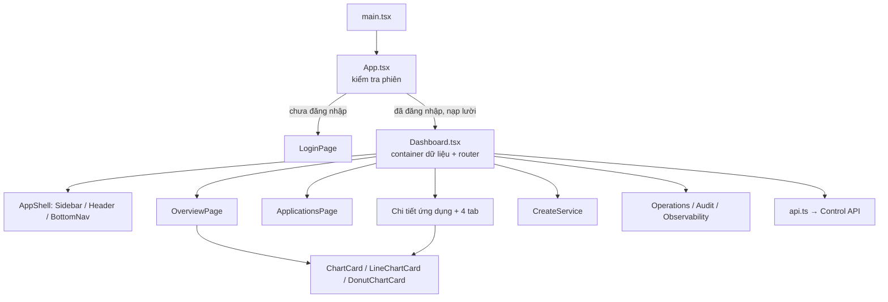

*Hình 4.1. Sơ đồ thành phần của Dashboard*

### 4.3. Cấu trúc thư mục

```text
platform/dashboard/
├── src/
│   ├── main.tsx, theme-init.ts      # điểm vào; script theme dạng module (tuân CSP)
│   ├── App.tsx                      # khung xác thực, nạp lười Dashboard
│   ├── Dashboard.tsx (412 dòng)     # container: dữ liệu dùng chung, thao tác, định tuyến
│   ├── api.ts (121), types.ts (227) # lớp gọi API và kiểu dữ liệu
│   ├── app/routing.tsx              # resolveRoute, AppLink, useDashboardPath
│   ├── config/                      # navigation.ts, shell.ts, chartSeries.ts, background.ts
│   ├── components/
│   │   ├── layout/                  # AppShell, Sidebar, Header, BottomNav, ThemeToggle
│   │   ├── ui/                      # ListToolbar, TableCard, ListError, Toast, ErrorBoundary...
│   │   ├── charts/                  # ChartCard, LineChartCard, DonutChartCard
│   │   └── background/              # AuroraBackground, CursorGlow
│   ├── features/
│   │   ├── auth/ dashboard/ applications/ deployments/ environment/
│   │   └── services/ operations/ audit/ observability/
│   ├── hooks/                       # usePolling, useStoredHistory, useResourceHistory,
│   │                                # useTheme, useInView, usePageVisibility, useCountUp...
│   ├── shared/                      # format.ts (ngày giờ), labels.ts (nhãn tiếng Việt)
│   └── styles/                      # tokens, base, glass, aurora, auth, ui, app (.css)
├── tests/filterApplications.test.ts # test logic lọc (ngoài src/, không vào bản build)
└── package.json                     # scripts: build, typecheck, test, lint
```

### 4.4. Nguyên tắc tổ chức

- **Theo tính năng (feature-based):** mỗi thư mục trong `features/` chứa trang, panel và logic riêng của tính năng đó; thành phần dùng chung nằm ở `components/`.
- **Container – presentational:** `Dashboard.tsx` giữ dữ liệu và hàm thao tác, truyền xuống qua props; các trang chỉ hiển thị và phát sự kiện. Nhờ vậy logic có thể tách ra hàm thuần để kiểm thử (như FE-01).
- **Một nguồn sự thật cho nhãn:** `shared/labels.ts` gom toàn bộ nhãn tiếng Việt của hành động/trạng thái (ví dụ `service.delete → "Xóa Web Service"`), tránh mỗi nơi tự đặt tên một kiểu.
- **Cấu hình tách khỏi giao diện:** menu, series biểu đồ, bố cục khung nằm ở `config/`.

### 4.5. Định tuyến

`resolveRoute(pathname)` chuyển đường dẫn thành một đối tượng có kiểu (`DashboardRoute`). Các tuyến:

| Đường dẫn | Màn hình |
|---|---|
| `/` | Tổng quan |
| `/applications` | Danh sách ứng dụng |
| `/applications/new` | Tạo Web Service |
| `/applications/<slug>[/deployments\|/environment\|/observability]` | Chi tiết ứng dụng theo tab |
| `/deployments`, `/operations`, `/audit`, `/observability` | Các trang tổng hợp |
| khác | Không tìm thấy |

Trường hợp `decodeURIComponent` lỗi (đường dẫn chứa mã % sai) được bắt và trả về "not-found" thay vì làm sập trang. `AppLink` chặn hành vi mặc định chỉ khi nhấp chuột trái thường; nhấp kèm Ctrl/Cmd/Shift vẫn mở tab mới như liên kết bình thường.

---

## 5. Giao tiếp với Control API và quản lý phiên

### 5.1. Lớp gọi API

Mọi lời gọi đi qua hàm `request()` trong `api.ts`:

- Dùng `fetch` với `credentials: "same-origin"`, thêm `content-type` khi có body.
- Phản hồi không thành công được chuyển thành `ApiError(message, status, code)`; `message` là câu tiếng Việt do server trả về, nếu không đọc được thì dùng "Không thể kết nối với hệ thống.".
- Phản hồi 204 trả `undefined`.
- Các hàm danh sách nhận `AbortSignal` để hủy khi dữ liệu mới thay thế hoặc khi rời trang.

| Mục đích | Endpoint |
|---|---|
| Phiên / đăng nhập / đăng xuất | `GET /api/v1/auth/session`, `POST /api/v1/auth/login`, `POST /api/v1/auth/logout` |
| Danh sách ứng dụng | `GET /api/v1/applications` |
| Nhật ký thao tác | `GET /api/v1/operations?limit=` |
| Nguồn mã được phép | `GET /api/v1/sources` |
| Deployment / release | `GET /api/v1/deployments?limit=`, `GET /api/v1/releases?limit=` |
| Kiểm toán | `GET /api/v1/audit-events?limit=` |
| Lịch sử CPU/RAM | `GET /api/v1/metrics/history?range=` |
| Xóa Web Service | `DELETE` trên ứng dụng tương ứng |

### 5.2. Luồng phiên đăng nhập

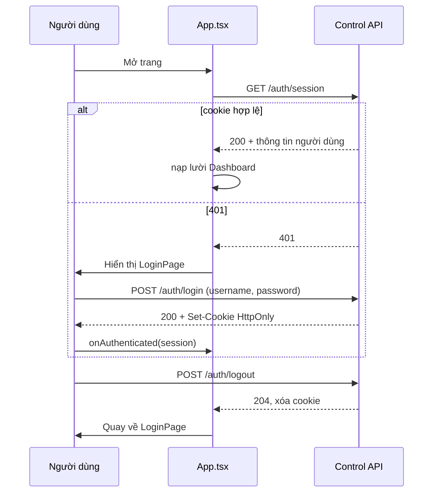

*Hình 5.1. Luồng kiểm tra phiên, đăng nhập và đăng xuất*

Chi tiết xử lý đăng nhập (`features/auth/useLogin.ts`): máy trạng thái `idle → loading → success | error`; cờ `busy` chặn gửi trùng; lỗi được phân loại thành **invalid** (sai thông tin), **locked** (mã 423 hoặc 429) và **network** (không có phản hồi) để hiện thông điệp phù hợp; khi thành công, giao diện giữ khoảnh khắc ngắn cho hiệu ứng rồi mới chuyển vào Dashboard. Việc kiểm tra quyền thực sự luôn nằm ở server: giao diện chỉ phản ánh trạng thái, không tự quyết định ai được phép.

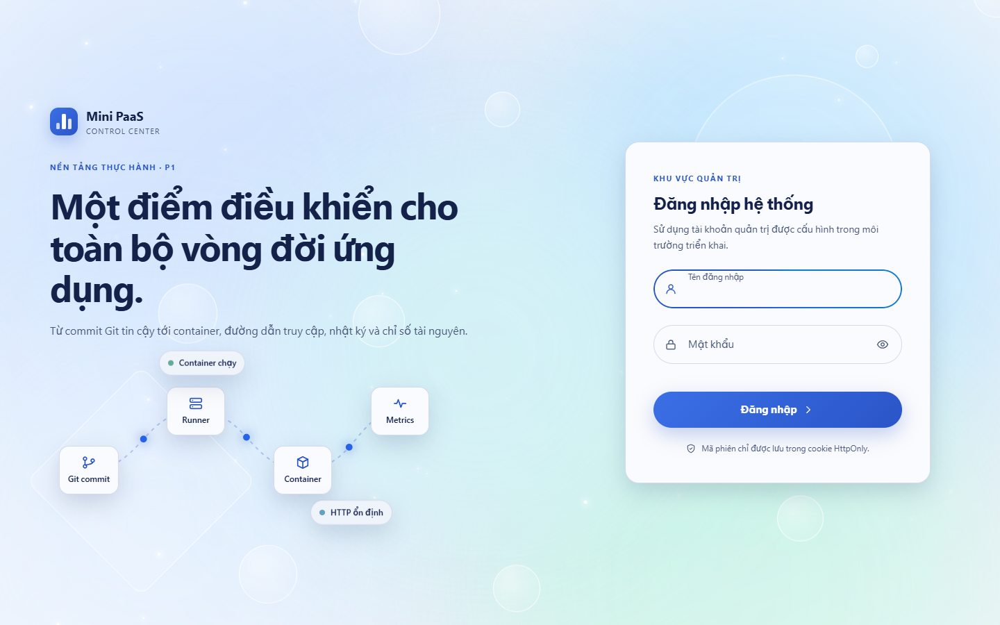

*Hình 1. Màn hình đăng nhập. Tài khoản/mật khẩu nằm trong `.env`, không xuất hiện trong ảnh.*

### 5.3. Hook `usePolling`

```ts
export function usePolling<T>(load: (signal: AbortSignal) => Promise<T>, intervalMs: number, resetKey?: string) {
  // ...
  useEffect(() => {
    if (!visible) return;                       // tab ẩn: không gọi API
    const controller = new AbortController();
    let busy = false;
    const run = async () => {
      if (busy) return;                         // không chồng lệnh
      busy = true;
      try { setData(await loadRef.current(controller.signal)); setError(""); }
      catch (e) { if (!controller.signal.aborted) setError(/* thông báo */); }
      finally { busy = false; /* ... */ }
    };
    void run();
    const timer = window.setInterval(() => void run(), intervalMs);
    return () => { controller.abort(); window.clearInterval(timer); };
  }, [visible, intervalMs, reloadTick, resetKey]);
  // ...
}
```

Hook giải quyết bốn vấn đề: (1) **không chồng lệnh** nhờ cờ `busy`; (2) **hủy request cũ** bằng `AbortController` khi đổi `resetKey` (ví dụ chuyển khoảng 1 giờ → 24 giờ) hoặc khi rời trang, tránh dữ liệu cũ ghi đè dữ liệu mới; (3) **tạm dừng khi tab ẩn** qua `usePageVisibility`; (4) giữ nguyên dữ liệu cũ khi một lần tải lỗi, đồng thời trả `error` để giao diện hiện thông báo kèm nút **Thử lại** (`reload`).

---

## 6. Thiết kế giao diện

### 6.1. Hệ thống token và hai chế độ sáng/tối

`styles/tokens.css` (196 dòng) định nghĩa các nhóm token: nền và bề mặt (`--page-bg`, `--surface`, `--surface-elevated`), viền, đổ bóng, chữ (`--text-strong`, `--text-muted`), màu chủ đạo (`--accent-1..3`), màu trạng thái (`--success`, `--warning`, `--danger`, `--info` cùng biến `-fg` và `-bg`), thẻ KPI, màu biểu đồ (`--chart-1..4`), thanh bên. Chế độ tối ghi đè cùng tên biến dưới `:root[data-theme="dark"]` và theo `prefers-color-scheme` khi người dùng chưa chọn. Quy ước: **component không viết màu cứng**, chỉ tham chiếu token. Màu biểu đồ được chọn để bốn đường khác hẳn nhau (xanh dương, cam, xanh lá, xanh ngọc) nhằm phân biệt được cả khi người xem khó phân biệt màu.

Quá trình thiết kế đi qua nhiều vòng chỉnh theo phản hồi của nhóm: bỏ tông tím–hồng, đưa thanh điều hướng về xanh than tối, tăng độ tương phản chữ–nền, bỏ các dòng chữ phụ dưới menu và rà soát toàn bộ token thay vì chỉ sửa một trang.

### 6.2. Bố cục

- **Máy tính:** thanh bên cố định (xanh than, có thể thu gọn), thanh đầu trang chứa đường dẫn breadcrumb, nút Làm mới, nút đổi theme và thông tin người dùng; nội dung chính theo lưới thẻ.
- **Máy tính bảng và điện thoại:** thanh bên thu lại; trên điện thoại xuất hiện `BottomNav` với các mục chính; lưới dùng `minmax(0, 1fr)` để cột không tràn.
- **Khung xương trang:** tiêu đề (eyebrow + h1 + mô tả) → thẻ KPI → thanh công cụ → bảng/biểu đồ; các trang danh sách dùng chung bố cục này để nhất quán.

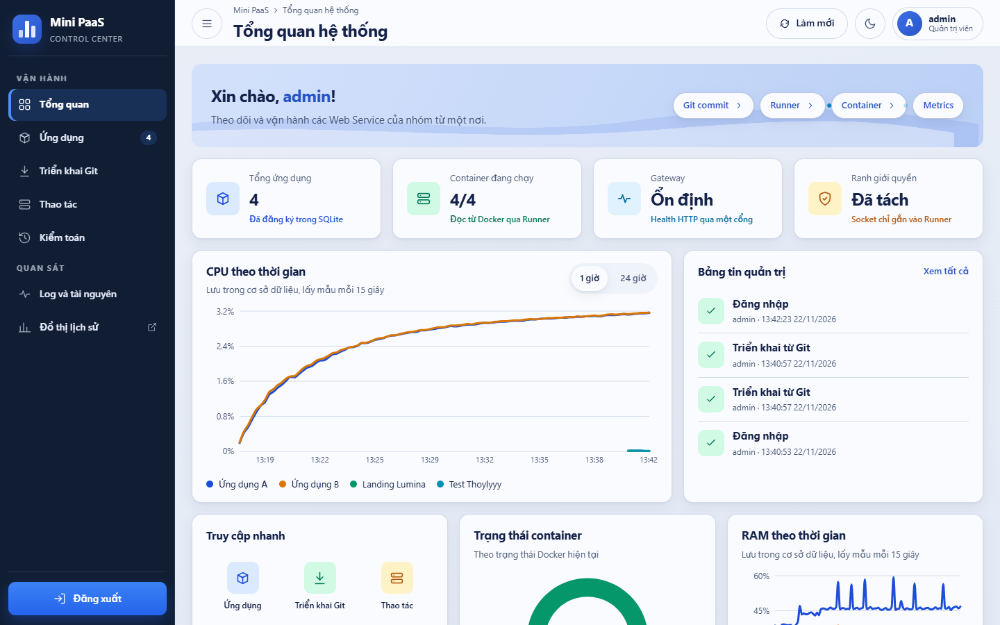

*Hình 2. Trang Tổng quan: lời chào, bốn thẻ KPI, biểu đồ đường CPU theo thời gian, bảng tin quản trị, truy cập nhanh*

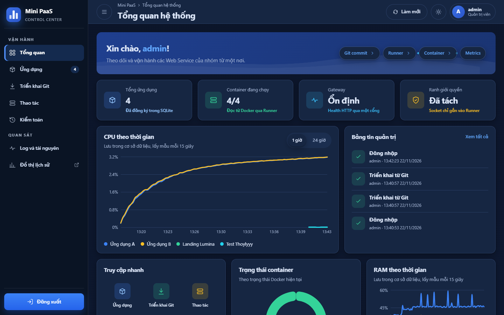

*Hình 3. Cùng trang Tổng quan ở chế độ tối (chỉ đổi giá trị token, không đổi component)*

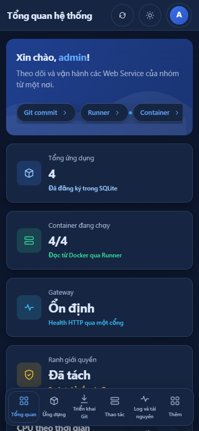

*Hình 4. Giao diện điện thoại 390×844*

### 6.3. Hiệu ứng chuyển động

Thư viện `motion` dùng cho chuyển cảnh đăng nhập → khu quản trị (`AnimatePresence`), khung nền Aurora chuyển sang chế độ "calm" sau đăng nhập, và đếm số cho thẻ KPI (`useCountUp`, chỉ chạy khi thẻ vào vùng nhìn thấy nhờ `useInView`). Hằng số thời lượng/đường cong gom ở `motion/constants` để thống nhất. Hiệu ứng chỉ mang tính phụ trợ: nếu `IntersectionObserver` không kích hoạt, bộ đếm dự phòng 1,2 giây vẫn hiển thị số thật.

### 6.4. Biểu đồ

`ChartCard` là khung dùng chung: tiêu đề, mô tả, các trạng thái tải/rỗng/lỗi, và bảng dữ liệu thay thế cho trình đọc màn hình. `LineChartCard` vẽ đường CPU/RAM bằng `recharts`, ẩn hoạt ảnh (`isAnimationActive={false}`) để biểu đồ cập nhật mượt khi polling; đường cần tối thiểu 2 mẫu mới hiển thị, nếu ít hơn thì hiện trạng thái rỗng "Đang thu thập số liệu, đường biểu diễn xuất hiện sau vài giây". Mỗi biểu đồ được bọc `ErrorBoundary` để lỗi hiển thị của một biểu đồ không làm hỏng cả trang.

---

## 7. Các màn hình và luồng sử dụng

Luồng chính của quản trị viên: **Tổng quan → Danh sách ứng dụng → Chi tiết ứng dụng → (Triển khai / Biến môi trường / Nhật ký & tài nguyên)**, kèm các trang tổng hợp để rà soát toàn hệ thống.

### 7.1. Danh sách ứng dụng

Liệt kê App A, App B và các Web Service động, mỗi dòng gồm tên và mô tả, phiên bản, đường dẫn (mở được bằng một cú nhấp), hai huy hiệu trạng thái (**container** và **HTTP**), mức CPU/RAM. Phía trên có bốn thẻ KPI (tổng ứng dụng, container đang chạy, CPU trung bình, RAM trung bình) và thanh công cụ lọc/tìm kiếm (chi tiết ở mục 10). Việc hiển thị tách riêng trạng thái container và trạng thái HTTP phản ánh đúng thiết kế hệ thống: container chạy chưa chắc ứng dụng đã khỏe.

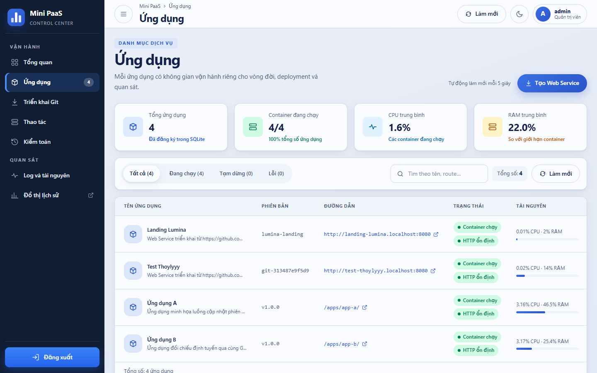

*Hình 5. Danh sách ứng dụng*

### 7.2. Chi tiết ứng dụng

Trang có bốn tab: **Tổng quan**, **Triển khai**, **Biến môi trường**, **Nhật ký & tài nguyên**. Tab Tổng quan gồm: thẻ phiên bản đang chạy và phiên bản mong muốn, trạng thái container, CPU, RAM; bảng **Điều khiển vận hành** (Dừng, Khởi động lại; nút phù hợp trạng thái hiện tại); **Thông tin dịch vụ** (URL truy cập, phiên bản thực tế/mong muốn, container, image, số biến môi trường, commit gần nhất); **Release gần đây**; **Lịch sử thao tác** chỉ của ứng dụng này; cuối trang là **Vùng nguy hiểm** để xóa Web Service.

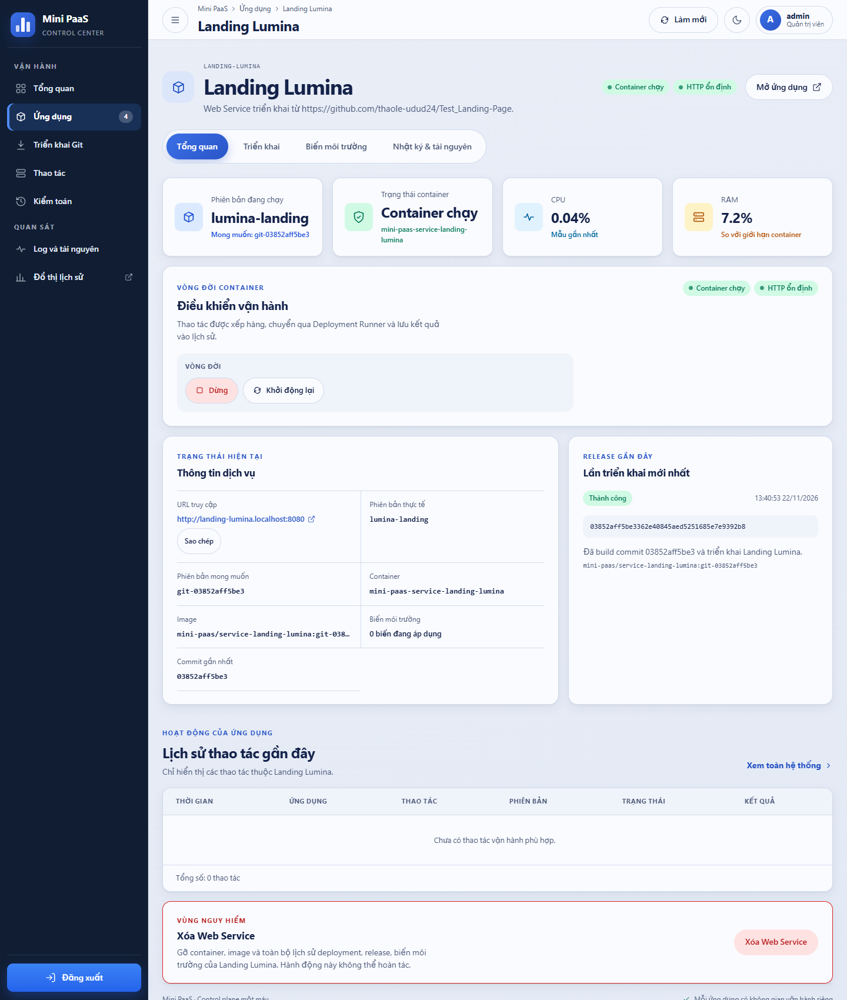

*Hình 6. Trang chi tiết Landing Lumina*

### 7.3. Tạo Web Service

Trang `/applications/new` chia hai bước trên cùng một form: (01) tên dịch vụ và slug; (02) repository GitHub công khai, nhánh hoặc tag (mặc định `main`) và build context (mặc định `.`). Cột bên phải liệt kê điều kiện cần chuẩn bị (repository công khai thuộc owner được phép, nhánh/tag, Dockerfile hợp lệ, ứng dụng nghe cổng 3000 và trả `/health`). Nút "Tạo và triển khai" đăng ký service rồi bắt đầu deployment đầu tiên.

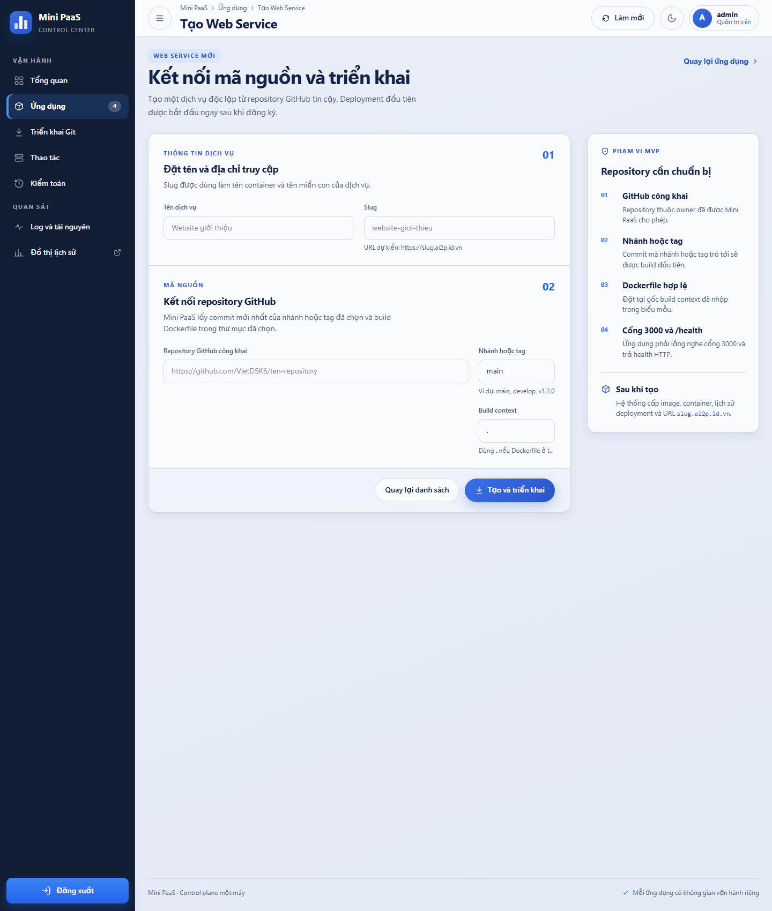

*Hình 7. Form tạo Web Service*

### 7.4. Triển khai Git

Chọn kho mã được Runner cho phép, xem tóm tắt (repository, ứng dụng đích, nhánh mặc định), triển khai **commit mới nhất** hoặc nhập **SHA 40 ký tự** cụ thể; bên dưới là lịch sử deployment kèm trạng thái và liên kết.


*Hình 8. Trang Triển khai Git*

### 7.5. Thao tác và Kiểm toán

Trang **Thao tác** liệt kê các operation bất đồng bộ (khởi động, dừng, khởi động lại, cập nhật) với trạng thái *Đang chờ / Đang xử lý / Thành công / Thất bại*; trang **Kiểm toán** liệt kê sự kiện quản trị (đăng nhập, triển khai, thay đổi biến môi trường, xóa service...) với tác nhân, kết quả và thời gian. Cả hai tự làm mới mỗi 5 giây.

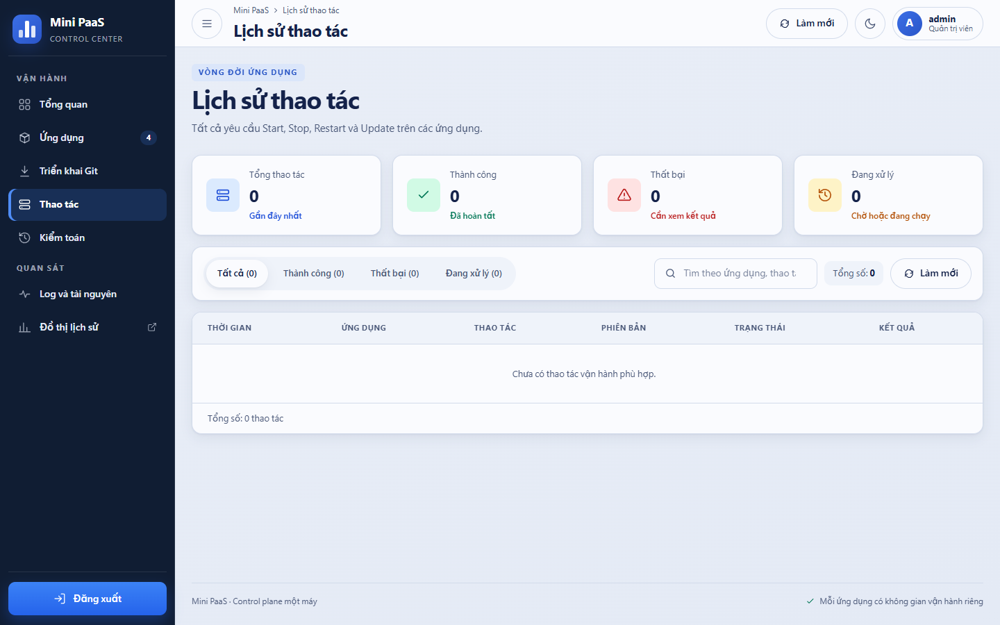

*Hình 9. Trang nhật ký Thao tác*

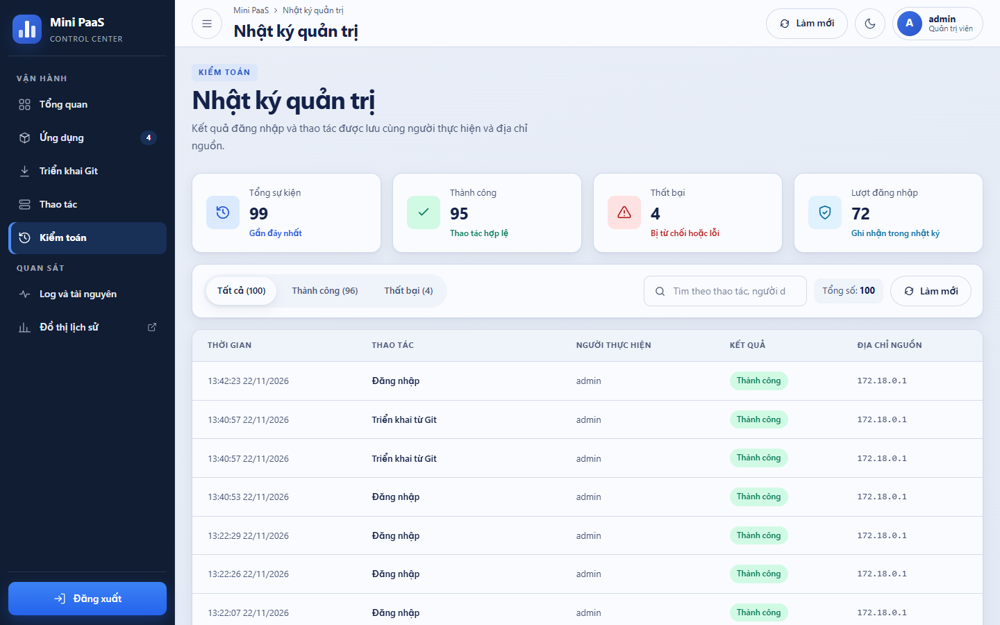

*Hình 10. Trang Kiểm toán*

### 7.6. Log và tài nguyên

Hiển thị log giới hạn (50/100/200 dòng) và số liệu CPU, RAM, PID, mạng của từng ứng dụng; liên kết "Đồ thị lịch sử" mở Grafana.

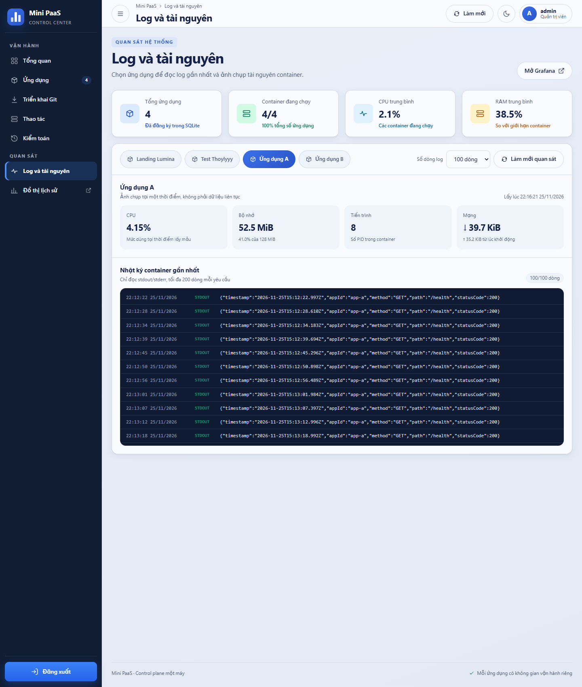

*Hình 11. Trang Log và tài nguyên*

---

## 8. Các trạng thái giao diện

Một giao diện quản trị đáng tin cậy phải xử lý đủ năm trạng thái cho mọi vùng dữ liệu, thay vì chỉ trường hợp "có dữ liệu".

| Trạng thái | Cách xử lý trong mã | Ví dụ |
|---|---|---|
| Đang tải | Khung xương (`skeleton`); biểu đồ có `aria-label="Đang tải biểu đồ"` | Danh sách ứng dụng khi chưa có dữ liệu |
| Rỗng | `panel-empty` hoặc dòng trong bảng, có tiêu đề và hướng dẫn | "Không có ứng dụng phù hợp bộ lọc."; "Chưa có thao tác vận hành phù hợp."; biểu đồ chưa đủ 2 mẫu |
| Thành công | `Toast` và cập nhật dữ liệu | Sau khi tạo service hoặc áp dụng biến môi trường |
| Lỗi | `ListError`/`inline-state--error` kèm nút **Thử lại**; `ErrorBoundary` cô lập lỗi theo vùng | "Chưa lấy được dữ liệu" |
| Xác nhận thao tác nguy hiểm | `DeleteServicePanel`: phải **gõ lại đúng slug** mới bật nút "Xóa vĩnh viễn" | Xóa Web Service |
| Bận | Nút bị vô hiệu khi ứng dụng đang có operation (`activeOperation`) hoặc đang gửi; Control API từ chối thao tác trùng | Xóa khi đang deploy |

Ví dụ rõ nhất về xác nhận có chủ đích là `DeleteServicePanel`: bấm "Xóa Web Service" chỉ mở khung xác nhận; nút xóa thật vẫn bị khóa cho đến khi `typed.trim() === application.slug`. Cách này (tương tự thao tác xóa kho mã trên GitHub) hiệu quả hơn hộp thoại "Bạn có chắc không?" vì buộc người dùng đọc tên đối tượng sắp bị xóa.

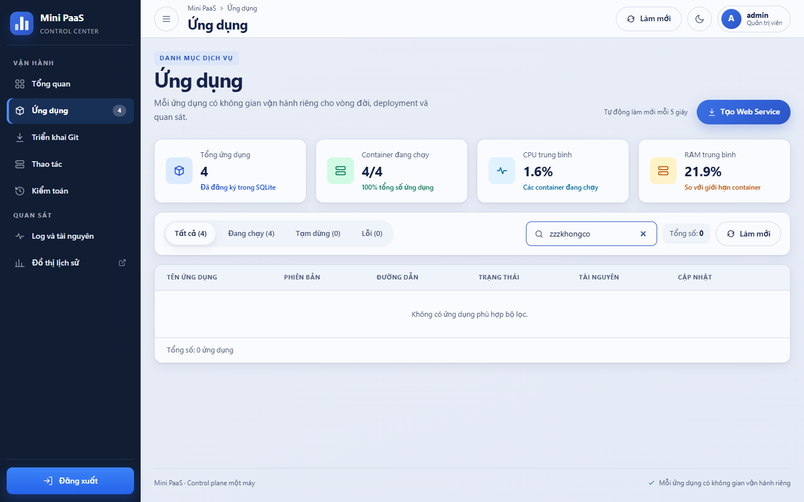

*Hình 12. Trạng thái rỗng khi từ khóa không khớp ứng dụng nào*

---

## 9. Validation và thông báo lỗi

### 9.1. Nguyên tắc hai lớp

Validation được thực hiện ở **hai lớp**: trình duyệt (thuộc tính HTML như `required`, `minLength`, `maxLength`; phản hồi tức thì) và Control API (JSON Schema trong route cùng `service.ts`; **lớp quyết định**, vì dữ liệu từ client không thể tin cậy). Lớp client chỉ phục vụ trải nghiệm; mọi quy tắc an toàn đều được server kiểm tra lại.

### 9.2. Form Tạo Web Service

| Trường | Quy tắc | Thông báo (tiếng Việt, từ server) |
|---|---|---|
| Tên dịch vụ | 2–80 ký tự | "Tên Web Service phải có từ 2 đến 80 ký tự." |
| Slug | Chữ thường, số, dấu gạch ngang; không trùng tên hệ thống | "Slug chỉ gồm chữ thường, số, dấu gạch ngang và không được trùng tên hệ thống." |
| Repository | `https://github.com/owner/repo`, công khai | "Chỉ hỗ trợ repository GitHub công khai dạng https://github.com/owner/repo." |
| Chủ sở hữu | Nằm trong `TRUSTED_GITHUB_OWNERS` (HTTP 403) | "Chủ sở hữu repository chưa nằm trong danh sách được phép." |
| Nhánh hoặc tag | Theo mẫu ký tự; cấm `..`, `//`, đuôi `/` hoặc `.lock` | "Nhánh hoặc tag không hợp lệ." |
| Build context | Đường dẫn tương đối an toàn, không chứa `..` | "Build context phải là đường dẫn tương đối an toàn trong repository." |

Ô slug tự chuyển về chữ thường khi gõ và có `aria-invalid` khi sai; thông báo lỗi hiện trong `div` có `role="alert"` để trình đọc màn hình đọc ngay.

### 9.3. Triển khai commit cụ thể

Trước khi gửi, giao diện kiểm tra SHA bằng biểu thức `^[0-9a-f]{40}$` (sau khi bỏ khoảng trắng và đổi chữ thường); sai thì báo "Commit phải là SHA đầy đủ gồm đúng 40 ký tự hexadecimal." Nếu chưa có kho mã nào được cho phép thì báo "Chưa có kho mã nào được Runner cho phép.".

### 9.4. Biến môi trường

Giới hạn do `control-api/src/environment.ts` quy định, giao diện hiển thị lại nguyên văn thông báo của server: tối đa **20 biến**; tên tối đa **64 ký tự**, viết hoa, bắt đầu bằng chữ cái, chỉ gồm chữ/số/gạch dưới ("Tên biến phải viết hoa, bắt đầu bằng chữ cái và chỉ chứa chữ cái, số hoặc dấu gạch dưới."); mỗi giá trị tối đa **2.048 byte**, tổng tối đa **8.192 byte**; có danh sách khóa bị bảo lưu (như `APP_ID`) không được ghi đè. Giá trị bí mật được mã hóa AES-256-GCM trong SQLite và **không bao giờ trả lại giao diện**: sau khi lưu chỉ hiển thị tên biến và trạng thái đã đặt.

### 9.5. Đăng nhập

Hai trường bắt buộc (`validateUsername`, `validatePassword`); thông báo lấy từ `features/auth/strings.ts` để thống nhất. Lỗi từ server được phân loại như ở mục 5.2. Giao diện **không** tiết lộ tài khoản có tồn tại hay không: thông điệp sai thông tin chung cho cả hai trường hợp.

### 9.6. Nguyên tắc viết thông báo

Mỗi thông báo trả lời ba câu hỏi: *điều gì sai*, *quy tắc đúng là gì*, *làm gì tiếp theo*. Thuật ngữ thống nhất (Web Service, triển khai, nhánh hoặc tag, build context), tránh thông điệp kỹ thuật thô như mã lỗi hoặc stack trace. Các thông điệp này nằm ở server (một nguồn) nên cùng một lỗi luôn hiện cùng một câu dù gọi từ Dashboard hay công cụ khác.

---

## 10. Nhiệm vụ bắt buộc FE-01: tìm kiếm và lọc danh sách ứng dụng

### 10.1. Yêu cầu

Theo Phân công §4.3: tìm kiếm/lọc theo tên, slug hoặc repository; trạng thái rỗng khi không có kết quả; viết test hoặc tách logic thành hàm kiểm thử được; rà thông báo lỗi tiếng Việt; chạy typecheck, test và production build.

### 10.2. Hiện trạng trước khi sửa

Trong `ApplicationsPage.tsx`, hàm `matchesFilter` và biểu thức tìm kiếm nằm cùng component. Có bốn tab lọc trạng thái và tìm theo tên/slug/route/mô tả, **nhưng**: (1) không tìm theo URL repository; (2) logic gắn với component nên không kiểm thử được độc lập; (3) Dashboard chưa có công cụ chạy test nào.

### 10.3. Thiết kế

Tách logic thành **hàm thuần** (không phụ thuộc React, không có hiệu ứng phụ), đặt ở `src/features/applications/filterApplications.ts`:

```ts
export type FilterId = "all" | "running" | "stopped" | "attention";

export function matchesFilter(application: ApplicationItem, filter: FilterId): boolean {
  const status = application.runtime.status;
  if (filter === "all") return true;
  if (filter === "running") return status === "running";
  if (filter === "stopped") return status === "stopped";
  return status !== "running" && status !== "stopped";   // "Lỗi": mọi trạng thái còn lại
}

// Tìm theo tên, slug, route, mô tả và URL repository; không phân biệt hoa/thường.
export function filterApplications(items: readonly ApplicationItem[], filter: FilterId, query: string): ApplicationItem[] {
  const needle = query.trim().toLowerCase();
  return items.filter((item) => matchesFilter(item, filter)
    && `${item.name} ${item.slug} ${item.route} ${item.description} ${item.repositoryUrl ?? ""}`.toLowerCase().includes(needle));
}
```

`ApplicationsPage.tsx` chỉ còn `const visible = filterApplications(items, filter, query);`. Mỗi tab hiển thị **số lượng** tương ứng (tính bằng `matchesFilter` trên toàn danh sách) nên người dùng thấy ngay có bao nhiêu ứng dụng lỗi mà không cần bấm.

Quyết định thiết kế đáng nói:

- **Tab "Lỗi" là phần bù:** mọi trạng thái không phải *running* hoặc *stopped* (ví dụ container khởi động lại liên tục, không khỏe, bị mất) đều xếp vào "Lỗi". Cách này đảm bảo không trạng thái lạ nào "biến mất" khỏi mọi tab.
- **`repositoryUrl ?? ""`:** ứng dụng mẫu App A/B không có repository (giá trị `null`); nếu nối thẳng sẽ ra chuỗi "null" và khớp nhầm khi người dùng gõ "null".
- **`trim()` + chữ thường:** tránh trường hợp gõ thừa dấu cách hoặc khác hoa/thường mà không thấy kết quả.
- **Hàm thuần nhận danh sách và trả danh sách mới:** không sửa dữ liệu gốc, dễ test và dễ dùng lại cho FE-02.

### 10.4. Hình minh họa

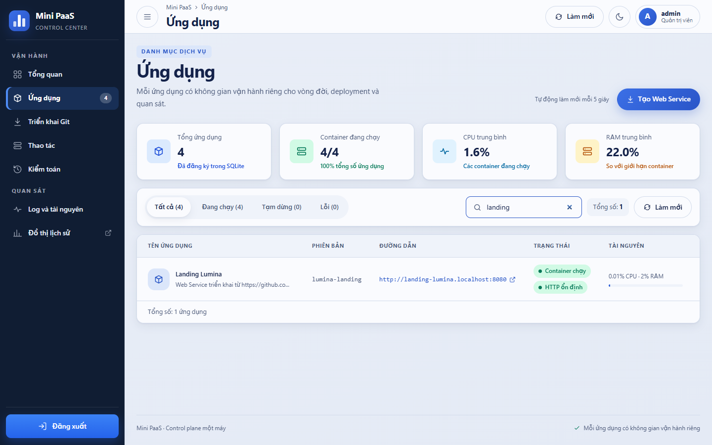

*Hình 13. Gõ "landing": chỉ còn ứng dụng khớp; bộ đếm "Tổng số: 1"*


*Hình 14. Tab "Đang chạy (4)"*

### 10.5. Công cụ kiểm thử

Dashboard chưa có test runner. Thay vì thêm thư viện (Vitest/Jest) cho 6 ca đơn giản, tôi dùng **`node --test`** có sẵn của Node 24, chạy trực tiếp file TypeScript nhờ *type stripping*. Test đặt ở `platform/dashboard/tests/` — **ngoài `src/`** nên không bị `tsc -b` quét và không đi vào bản build. Script: `"test": "node --test tests/*.test.ts"`. Ràng buộc: module được test chỉ được `import type` từ các file khác (bị xóa lúc chạy) và test phải import bằng đuôi `.ts`; nếu sau này logic cần import giá trị từ module khác thì nên chuyển sang Vitest.

### 10.6. Các ca kiểm thử

| # | Ca kiểm thử | Kết quả |
|---|---|---|
| 1 | Tab "Tất cả" trả đủ danh sách | Đạt |
| 2 | Tab Đang chạy / Tạm dừng / Lỗi lọc đúng theo trạng thái | Đạt |
| 3 | Tìm kiếm không phân biệt hoa/thường, bỏ khoảng trắng đầu cuối | Đạt |
| 4 | Tìm theo URL repository | Đạt |
| 5 | Không khớp thì trả danh sách rỗng (kích hoạt trạng thái rỗng) | Đạt |
| 6 | Kết hợp tab và từ khóa | Đạt |

Kết quả `npm test`: `tests 6 · pass 6 · fail 0` (thời gian chạy ~0,23 giây). Các lệnh đã chạy:

```bash
# trong platform/dashboard
npm run typecheck   # tsc -b --pretty false  → đạt
npm run build       # tsc -b && vite build   → đạt
# test dùng Node 24 (máy có Node 20 thì chạy trong container)
docker run --rm -v "<đường-dẫn>/platform/dashboard:/w" -w /w node:24-alpine npm test   # 6/6 đạt
```

### 10.7. Thông báo lỗi và hướng dẫn nhập liệu

Phần rà soát thông báo ở form tạo Web Service cho thấy các thông điệp từ `service.ts` đã là tiếng Việt, nêu rõ quy tắc đúng và dùng thuật ngữ thống nhất (xem bảng ở mục 9.2). Form hiển thị thêm gợi ý ngay dưới ô nhập: "Ví dụ: main, develop, v1.2.0" cho nhánh/tag, "Dùng `.` nếu Dockerfile ở thư mục gốc" cho build context, "URL dự kiến" cho slug. Tôi không đổi nội dung các thông điệp này vì không phát hiện chỗ sai hay thuật ngữ lệch; việc rà soát là đối chiếu có chủ đích chứ không phải sửa cho có.

---

## 11. Ba tính năng bổ sung

### 11.1. Biểu đồ lịch sử CPU/RAM bền vững

**Vấn đề:** biểu đồ dựa trên số liệu tức thời của phiên làm việc nên mất sạch khi tải lại trang. **Giải pháp:** Control API chạy `sampler.ts` lấy mẫu từ Runner mỗi **15 giây**, ghi vào bảng `resource_samples` (migration v7), giữ **24 giờ** rồi tự dọn; `GET /api/v1/metrics/history?range=1h|24h` trả các điểm. Phía Dashboard, `useStoredHistory` gọi API mỗi 30 giây, đổi mỗi điểm thành `{ time, [tên ứng dụng]: phần trăm }` rồi gộp theo thời điểm để một biểu đồ vẽ nhiều đường. Nhãn thời gian dùng `Intl.DateTimeFormat("vi-VN")` (giờ:phút cho 1 giờ, ngày/tháng giờ:phút cho 24 giờ). `usePolling` nhận `range` làm `resetKey` nên đổi khoảng thời gian sẽ hủy request cũ; hook cũng kiểm tra `history.range !== range` để không vẽ dữ liệu của khoảng trước khi dữ liệu mới về.

### 11.2. Xóa Web Service

Luồng: `DeleteServicePanel` (gõ lại slug) → `DELETE` ở Control API → Runner gỡ container, các tag image `mini-paas/service-<slug>` và bản ghi, đồng thời Control API xóa deployment/release/biến môi trường liên quan. Server chặn khi ứng dụng đang có thao tác khác (`activeDeletions`, `activeOperation`), nên nút ở giao diện bị khóa tương ứng. Hành động được ghi vào nhật ký kiểm toán với nhãn "Xóa Web Service".

### 11.3. Chọn nhánh hoặc tag

Form tạo service có ô "Nhánh hoặc tag" (mặc định `main`). Server kiểm tra bằng `validateSourceRef` (theo mẫu ký tự, cấm `..`, `//`, đuôi `/` hoặc `.lock`) rồi Runner phân giải ref thành SHA 40 ký tự. Giá trị trả về của GitHub `commits/{ref}` rất lớn (~265 KB) nên Runner dùng `Accept: application/vnd.github.sha` để chỉ nhận SHA; thêm tham số `?cb=` để tránh phản hồi cache `max-age=60` của GitHub khiến deploy "latest" lấy nhầm commit cũ.

Các thay đổi này nằm trong commit `f514974` (backend) và `4722f89` (frontend); backend có test (Control API 17/17, Runner 33/33).

---

## 12. Nhiệm vụ tùy chọn FE-02 và FE-03

**FE-02 — lọc lịch sử deployment.** Theo đúng mẫu FE-01: hàm thuần `filterDeployments(items, filter, applicationId)` trong `features/deployments/filterDeployments.ts`; bộ lọc *Mọi kết quả / Thành công / Thất bại / Đang xử lý* (gom `queued` và `running`) và bộ lọc theo ứng dụng, nối vào `GitDeploymentPanel`. Tiêu đề hiện `đã lọc/tổng` bản ghi; khi không khớp có trạng thái rỗng "Không có deployment phù hợp bộ lọc". Test `tests/filterDeployments.test.ts` (3 ca: đủ danh sách, lọc theo kết quả, lọc theo ứng dụng và kết hợp).

**FE-03 — sao chép URL.** `CopyUrlButton` gọi `navigator.clipboard.writeText` với URL tuyệt đối, hiện "Đã sao chép URL." hoặc "Không sao chép được, hãy chọn và sao chép thủ công." trong vùng `role="status"` ngay cạnh nút, tự tắt sau 2,5 giây. Có xử lý lỗi vì clipboard chỉ khả dụng ở HTTPS/`localhost` và có thể bị từ chối. Đặt tại dòng "URL truy cập" của trang chi tiết ứng dụng.

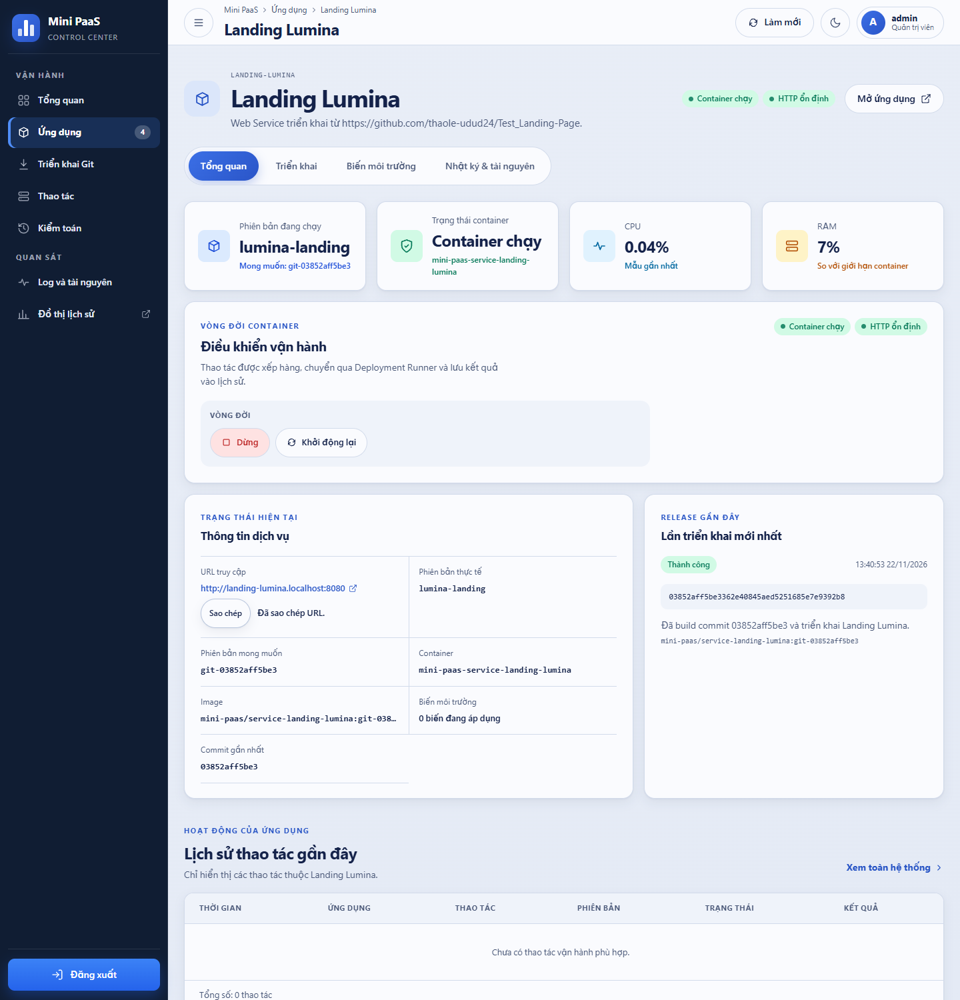

*Hình 15. Nhấn "Sao chép" ở dòng URL truy cập: hiện "Đã sao chép URL."*

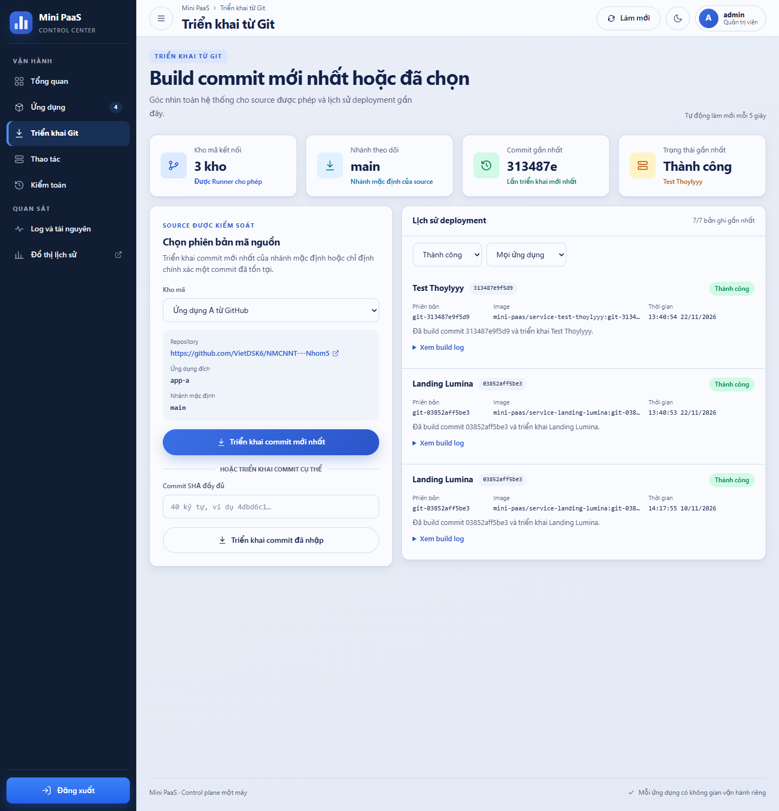

*Hình 16. Lọc lịch sử deployment theo "Thành công" (7/7 bản ghi)*

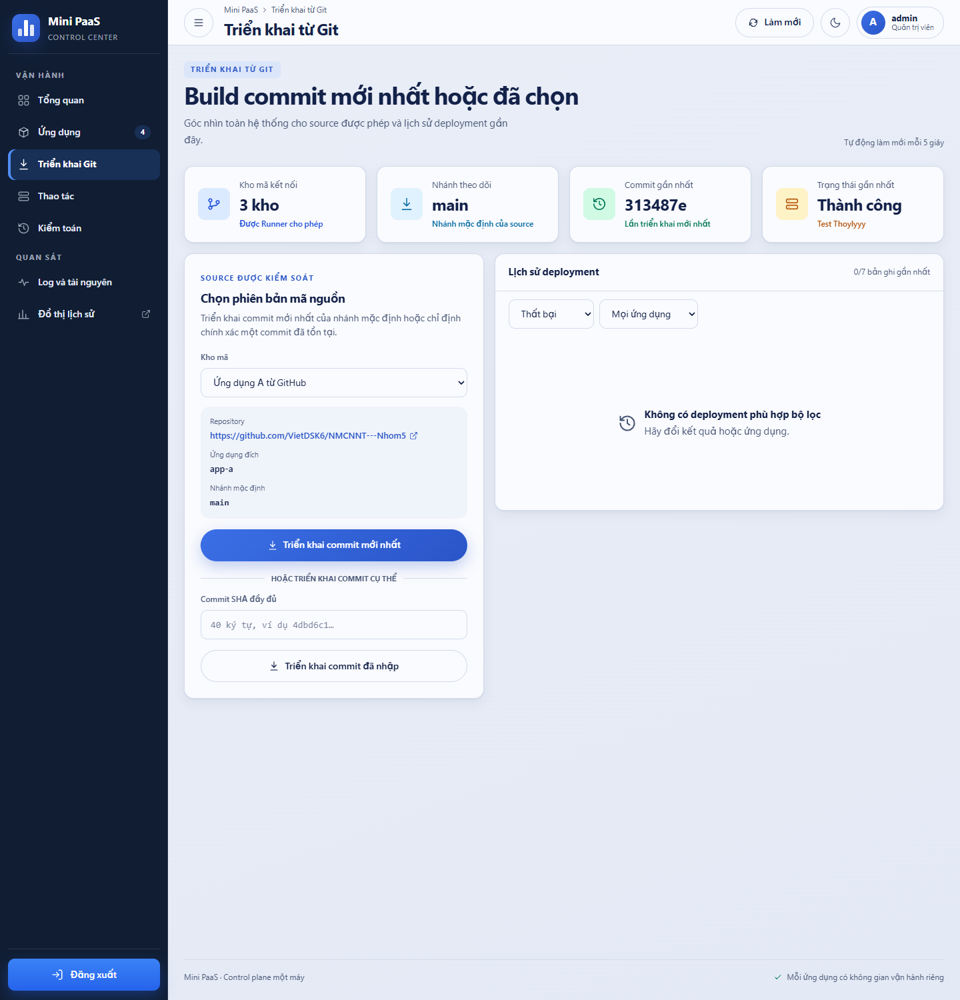

*Hình 17. Lọc "Thất bại": 0/7, hiện trạng thái rỗng*

Kết quả: `npm test` 9/9 đạt (6 + 3), lint, typecheck và build đạt. Nút sao chép được kiểm trên Chrome bằng Playwright: bấm được và clipboard chứa đúng `http://landing-lumina.localhost:8080/`. Khi bấm thử phát hiện **lỗi bố cục thật**: ô giá trị có `overflow: hidden` cắt mất nút nên không bấm được; đã sửa bằng lớp `fact-url` (cho dòng URL xuống hàng). Hai ô lọc deployment cũng được thêm đệm vì ban đầu dính sát mép thẻ.

---

## 13. Bảo mật ở phía giao diện

| Rủi ro | Biện pháp trong Dashboard |
|---|---|
| Đánh cắp token phiên qua XSS | Token ở cookie HttpOnly; Dashboard không lưu token ở `localStorage` hay biến JS |
| XSS qua nội dung lạ | React thoát (escape) chuỗi mặc định; không dùng `dangerouslySetInnerHTML` cho dữ liệu từ API; CSP cấm script/style nội tuyến |
| CSRF | Cookie `SameSite=Strict`; Control API kiểm tra `Origin` với yêu cầu thay đổi dữ liệu |
| Lộ bí mật | Giá trị biến môi trường không bao giờ trả lại giao diện; ảnh chụp và báo cáo không chứa mật khẩu/token |
| Thao tác nhầm | Xác nhận gõ lại slug trước khi xóa; nút bị khóa khi ứng dụng đang bận |
| Tin tưởng dữ liệu client | Mọi validation được server kiểm tra lại; giao diện chỉ phản ánh |
| Lỗi hiển thị lan rộng | `ErrorBoundary` bọc từng biểu đồ/khối |

Giới hạn cần nói rõ: các biện pháp trên **không thay thế** kiểm soát quyền ở server, và Dashboard không ngăn được người có quyền Docker host đọc cấu hình container (đã nêu ở báo cáo chung).

---

## 14. Hiệu năng và tính đáp ứng

### 14.1. Kích thước bản build

Kết quả `vite build` (kích thước tệp thô, chưa nén gzip):

| Tệp | Kích thước |
|---|---|
| `Dashboard-*.js` (khu quản trị, nạp lười) | ≈ 441 KiB (451.659 byte) |
| `index-*.js` (khung ứng dụng + đăng nhập) | ≈ 392 KiB (401.789 byte) |
| `index-*.css` | ≈ 64 KiB (65.769 byte) |
| Phông Be Vietnam Pro (woff2, mỗi độ đậm) | ≈ 11–12 KiB |

Việc tách `Dashboard` bằng `React.lazy` giúp màn hình đăng nhập không phải tải code của biểu đồ và các trang quản trị cho đến khi người dùng đăng nhập. Gói `index` còn lớn vì chứa React, `motion` và phần dùng chung; có thể cải thiện thêm bằng tách thư viện hiệu ứng (hướng phát triển).

### 14.2. Tối ưu thời gian chạy

- **Polling có điều kiện:** dừng khi tab ẩn; không chồng lệnh; hủy request cũ.
- **Biểu đồ không hoạt ảnh khi cập nhật** để tránh nhấp nháy theo mỗi lần polling.
- **Bộ đếm KPI chỉ chạy khi nhìn thấy** (`useInView`).
- **Giới hạn số dòng** log/audit/operation mỗi lần tải.

### 14.3. Responsive

Layout được kiểm bằng Playwright (Chrome) trên nhiều kích thước màn hình và nhiều trang cho cả hai chế độ sáng/tối; không phát hiện tràn ngang sau khi sửa các lỗi lưới (mục 16). Ảnh minh họa chế độ tối và điện thoại ở mục 6.2. Đây là kiểm thử thủ công bằng script và ảnh chụp, **chưa phải bộ test hồi quy tự động**.

---

## 15. Kiểm thử và kết quả

### 15.1. Chiến lược

Vì Dashboard là lớp trình bày, trọng tâm kiểm thử đặt vào ba nhóm: (1) **logic thuần** (lọc/tìm kiếm) — test tự động; (2) **kiểu và biên dịch** — typecheck, production build; (3) **hành vi trên trình duyệt thật** — kiểm thủ công bằng Playwright và đối chiếu ảnh; kèm (4) **kiểm thử tích hợp backend** của các tính năng mới (Control API và Runner).

### 15.2. Bảng kết quả

| Kiểm tra | Lệnh / cách thực hiện | Kết quả |
|---|---|---|
| Typecheck | `npm run typecheck` (`platform/dashboard`) | Đạt |
| Test logic tìm kiếm/lọc | `npm test` (Node 24, `node --test`) | 9/9 đạt (6 lọc ứng dụng + 3 lọc deployment) |
| Production build | `npm run build` | Đạt |
| Control API | chạy trong `node:24-alpine` (cần `node:sqlite`) | 17/17 đạt |
| Runner | `node --test` | 33/33 đạt |
| Luồng thực tế | Tạo service từ `Test_Thoylyyy` và `Test_Landing-Page` → build → chạy → mở theo hostname | Đạt trên máy phát triển |
| Responsive/theme | Playwright, nhiều kích thước × hai theme | Không tràn ngang sau khi sửa |

### 15.3. Điều chưa kiểm thử

- Chưa có test component (React Testing Library) hay test end-to-end tự động.
- ESLint chạy trong thư mục riêng dùng TypeScript 6 vì `typescript-eslint` chưa hỗ trợ TypeScript 7.
- Chưa đo Lighthouse/Web Vitals; số liệu hiệu năng ở mục 14 chỉ là kích thước gói.
- Chưa kiểm tra trên Safari/Firefox; ảnh và kiểm thử dùng Chrome.

---

## 16. Lỗi đã gặp và bài học

| # | Hiện tượng | Nguyên nhân | Cách xử lý | Kết quả / bài học |
|---|---|---|---|---|
| 1 | Chữ bị che bởi nền khi đổi trang | Lớp aurora cố định có `z-index: 0` đè lên nội dung không định vị | Đặt `--z-background: -1` | Chữ hiển thị đúng ở mọi trang; luôn gán tầng (z-index) có chủ đích cho lớp trang trí |
| 2 | Script theme và hiệu ứng bị chặn | CSP `script-src 'self'; style-src 'self'` cấm mã nội tuyến | Chuyển script theme thành module `theme-init.ts`; bỏ chế độ `popLayout` của thư viện hiệu ứng vì nó chèn `<style>` nội tuyến | Giữ nguyên CSP; nên chọn thư viện tương thích chính sách bảo mật thay vì nới chính sách |
| 3 | Số KPI đứng ở 0 | `IntersectionObserver` đôi khi không kích hoạt | `useInView` thêm bộ đếm dự phòng 1,2 giây | KPI luôn hiển thị; hiệu ứng không được làm mất dữ liệu |
| 4 | Trang phình cao, tràn ngang | Bảng dữ liệu thay thế của biểu đồ không bị ẩn đúng; lưới ngầm định tràn cột | Bọc bảng trong `div.sr-only`; dùng `minmax(0, 1fr)`; `position: relative` cho `.card` | Không còn tràn ngang; phần tử con của lưới cần `min-width: 0` |
| 5 | `source_metadata_invalid` khi chọn nhánh/tag | JSON `commits/{ref}` của GitHub rất lớn (~265 KB) | Dùng `Accept: application/vnd.github.sha` | Phân giải đúng SHA; yêu cầu đúng định dạng nhỏ nhất cần thiết |
| 6 | Deploy "latest" lấy commit cũ | GitHub cache phản hồi `max-age=60` | Thêm tham số `?cb=` | Lấy đúng commit mới |
| 7 | ESLint không hỗ trợ TypeScript 7 | `typescript-eslint` giới hạn phiên bản TypeScript | Chạy lint trong thư mục riêng dùng TypeScript 6 | Lint chạy được mà không hạ cấp dự án |
| 8 | Trang Ứng dụng đứng ở khung xương, `/api/v1/sources` trả 504 | Sau khi Docker khởi động lại, container của Web Service mất; việc đọc trạng thái từng service chờ hết thời gian; đồng thời hết 60 yêu cầu/giờ của API GitHub không xác thực | Chờ hạn mức được đặt lại rồi triển khai lại hai service | Giao diện nên hiển thị lỗi cục bộ rõ hơn khi một nguồn dữ liệu chậm; nên cấu hình token GitHub chỉ-đọc |
| 10 | Nút "Sao chép" không bấm được | Ô giá trị `dd` có `overflow: hidden; white-space: nowrap` cắt phần tử con | Thêm lớp `fact-url` (flex, cho xuống hàng) | Playwright báo "dd intercepts pointer events" nên phát hiện được; kiểm thử trên trình duyệt thật bắt được lỗi mà typecheck/test logic không bắt được |
| 9 | Ảnh chụp có dải trắng ở sidebar và cuối trang | Chế độ chụp cả trang của Playwright không kéo dài sidebar/nền cao đúng bằng khung nhìn | Chụp bằng khung nhìn cao 1700px | Không phải lỗi giao diện; cần phân biệt lỗi sản phẩm với lỗi công cụ đo |

---

## 17. Đối chiếu với kiến thức môn học

| Kiến thức nền tảng | Biểu hiện trong phần Dashboard |
|---|---|
| Mô hình Client–Server, HTTP | SPA gọi REST/JSON qua Gateway cùng origin; mã trạng thái 401/403/423/429/504 được xử lý |
| Reverse proxy, định tuyến | Nginx trả `index.html` cho mọi tuyến SPA và chuyển `/api` tới Control API |
| Xác thực, phiên, cookie | Cookie HttpOnly/SameSite/Secure; kiểm tra phiên bằng `GET /auth/session` |
| Bảo mật ứng dụng Web | CSP, chống XSS/CSRF, không lộ bí mật, validation hai lớp |
| Tiến trình bất đồng bộ | Operation trả 202; giao diện polling để theo dõi `queued → running → succeeded/failed` |
| Tài nguyên CPU/RAM | Hiển thị phần trăm CPU/RAM theo container; lịch sử lấy mẫu 15 giây, giữ 24 giờ |
| Container và image | Hiển thị container, image, commit; xóa service gỡ cả image tag |
| Quan sát hệ thống | Log giới hạn, biểu đồ, liên kết Grafana; phân biệt trạng thái container và health HTTP |
| Quy trình phát triển | Git theo nhánh `feature/web-*`, commit quy ước, Pull Request; test và build trước khi hợp nhất |

Một điểm đáng nhấn: **giao diện không phải nơi thực thi chính sách bảo mật**. Dashboard chỉ làm cho các ràng buộc (owner allowlist, giới hạn biến môi trường, chặn thao tác trùng) dễ hiểu; việc ép buộc luôn ở Control API và Runner.

---

## 18. Phần báo cáo chung do Thảo phụ trách

Theo bảng phân công báo cáo, tôi phụ trách và đã soạn các phần sau trong [báo cáo chung](BAO_CAO_BAI_TAP_LON_TONG.md):

| Phần | Vị trí | Nội dung |
|---|---|---|
| Chương 2 — Dashboard Web và API | Mục 2 và 5 của báo cáo này; cơ sở HTTP/reverse proxy ở §2.2 báo cáo chung | SPA, cookie phiên, giao tiếp REST qua Gateway |
| Chương 4 — Dashboard và hướng dẫn sử dụng | §4.2 và **§4.4** báo cáo chung | Giao diện, luồng sử dụng, ba tính năng mới |
| Chương 5 — Kiểm thử Dashboard | **§5.4** báo cáo chung | Typecheck, 6 test, build |

Phần Chương 3 và "Triển khai ứng dụng mẫu" thuộc Duy; tôi chỉ phản biện theo phân công.

---

## 19. Hạn chế và hướng phát triển

### 19.1. Hạn chế hiện tại

- FE-01, FE-02, FE-03 đã có mã nhưng chưa commit (xem mục 20); FE-03 đã kiểm trên Chrome.
- Test chỉ bao phủ logic lọc; chưa có test component, test end-to-end, kiểm thử trình duyệt khác Chrome, Lighthouse.
- Biểu đồ dùng polling: số liệu trễ tối đa 30 giây và tốn yêu cầu định kỳ; chưa dùng cơ chế đẩy (SSE/WebSocket).
- Gói JavaScript khởi đầu vẫn lớn (~392 KiB thô) do gom cả thư viện hiệu ứng.
- Nhãn "URL dự kiến" trên form tạo service đang dùng tên miền cố định `ai2p.id.vn`, trong khi môi trường cục bộ phục vụ ở `*.localhost:8080`; ô "Build context" nằm lệch bố cục so với ô repository.
- Dashboard chưa có nhiều tài khoản hay phân quyền (đúng phạm vi một quản trị viên).
- API GitHub không xác thực chỉ cho 60 yêu cầu/giờ; khi vượt hạn mức thì không triển khai được cho đến khi được đặt lại.

### 19.2. Hướng phát triển (theo thứ tự ưu tiên)

1. Chuyển sang Vitest + React Testing Library khi số logic cần test tăng; thêm test end-to-end cho luồng đăng nhập → tạo service → xóa.
3. Hiển thị lỗi cục bộ cho từng khối dữ liệu để một nguồn chậm không làm trống cả trang; lấy tên miền hiển thị từ cấu hình thay vì ghi cứng.
4. Cấu hình token GitHub chỉ-đọc để tránh giới hạn tốc độ.
5. Giảm kích thước gói khởi đầu (tách thư viện hiệu ứng, nạp biểu đồ theo tuyến).
6. Cân nhắc SSE cho trạng thái operation/deployment thay cho polling.

---

## 20. Bằng chứng, cách chạy lại và xác nhận

### 20.1. Cách chạy lại

```bash
cp team.env.example .env        # sao chép cấu hình mẫu
make up                         # dựng stack; Dashboard tại http://127.0.0.1:8080
cd platform/dashboard
npm ci && npm run typecheck && npm run build
npm test                        # cần Node 24 (hoặc chạy trong node:24-alpine)
```

### 20.2. Commit của tôi trong lịch sử Git (`thaole-udu24`)

| Commit | Ngày | Nội dung |
|---|---|---|
| `2a10987` | 03/11/2026 | feat(web): làm mới toàn bộ giao diện admin, theme sáng/tối, bố cục mới, tối ưu hiệu năng |
| `f514974` | 10/11/2026 | feat(back): lưu lịch sử CPU/RAM vào SQLite, xóa Web Service, chọn nhánh/tag, chống cache GitHub |
| `4722f89` | 10/11/2026 | feat(web): biểu đồ lịch sử CPU/RAM, xóa Web Service, chọn nhánh/tag, sửa lỗi bảng ẩn làm phình trang |
| `675ebfc` | 10/11/2026 | docs(all): mô tả lịch sử CPU/RAM, xóa Web Service và chọn nhánh/tag |

### 20.3. Việc phải làm trước khi nộp

- **FE-01/02/03 chưa được commit:** `filterApplications.ts`, `filterDeployments.ts`, `CopyUrlButton.tsx`, các file đã sửa (`ApplicationsPage`, `ApplicationSummary`, `GitDeploymentPanel`, `package.json`) và thư mục `tests/` đang là thay đổi chưa commit. Cần commit theo quy ước nhóm (nhánh `feature/web-*`, thông điệp `feat(web): ...`, hợp nhất `origin/development`, không push `main`) để có bằng chứng Git.
- Ảnh chụp lấy từ stack chạy trên máy phát triển (`127.0.0.1:8080`), không phải VPS; không dùng làm bằng chứng nghiệm thu T01–T08.
- Báo cáo được soạn với sự hỗ trợ của công cụ AI (Claude Code); AI được khai báo ở Phụ lục B của báo cáo chung. Tôi cần đọc lại, chạy lại các lệnh ở mục 10.6 và 20.1, và tự giải thích được mọi phần trước khi nộp.

### 20.4. Xác nhận

Theo mẫu `MAU_PHIEU_DONG_GOP_CA_NHAN.md`: tôi đã đọc, chỉnh sửa, chạy lại và có thể giải thích sản phẩm kỹ thuật ghi trong báo cáo này.

| Họ tên | Xác nhận | Ngày |
|---|---|---|
| Lê Thị Thảo | _(chưa xác nhận — cần chính Thảo điền)_ | |

---

## Phụ lục A. Câu hỏi bảo vệ dự kiến

1. **Vì sao Dashboard không lưu token ở `localStorage`?** Vì token nằm trong cookie HttpOnly nên JavaScript không đọc được; nếu có XSS, kẻ tấn công cũng không lấy được token. Trạng thái đăng nhập được xác định bằng `GET /auth/session`.
2. **Vì sao chọn polling thay vì WebSocket?** Quy mô một quản trị viên và dữ liệu thay đổi chậm; polling đơn giản, dễ gỡ lỗi, qua được Gateway mà không cần cấu hình nâng cấp kết nối. Đã xử lý các nhược điểm bằng `usePolling` (không chồng lệnh, hủy request cũ, dừng khi tab ẩn).
3. **`usePolling` ngăn dữ liệu cũ ghi đè dữ liệu mới như thế nào?** Mỗi lần đổi `resetKey` hoặc rời trang, `AbortController` hủy request đang chạy; kết quả của request bị hủy không được ghi vào state.
4. **Tại sao tách `filterApplications` thành hàm thuần?** Để kiểm thử độc lập không cần dựng React; hàm không có hiệu ứng phụ nên kết quả chỉ phụ thuộc đầu vào, và dùng lại được cho FE-02.
5. **Tab "Lỗi" lọc những trạng thái nào?** Mọi trạng thái không phải *running* hoặc *stopped*; thiết kế này đảm bảo không trạng thái lạ nào biến mất khỏi mọi tab.
6. **Vì sao dùng `repositoryUrl ?? ""` trong chuỗi tìm kiếm?** Ứng dụng mẫu không có repository (`null`); nếu nối thẳng sẽ ra chữ "null" và khớp nhầm.
7. **Validation ở client và server khác nhau thế nào, cái nào quyết định?** Client để phản hồi nhanh; server (JSON Schema + `service.ts`) là lớp quyết định vì không thể tin dữ liệu từ trình duyệt.
8. **Tại sao xác nhận xóa bằng cách gõ lại slug?** Buộc người dùng đọc đúng đối tượng sắp xóa, giảm thao tác nhầm hơn hộp thoại có/không; nút xóa bị khóa tới khi `typed.trim() === slug`.
9. **CSP ảnh hưởng thế nào đến cách viết giao diện?** Không được dùng script/style nội tuyến: script theme chuyển thành module; thư viện hiệu ứng chèn `<style>` bị chặn nên bỏ chế độ đó.
10. **Giao diện có đảm bảo an toàn không?** Không; giao diện chỉ phản ánh. Việc ép buộc (allowlist owner, giới hạn biến môi trường, chặn thao tác trùng, xác thực) nằm ở Control API và Runner.
11. **Vì sao hai huy hiệu trạng thái (container và HTTP) tách riêng?** Container đang chạy chưa chắc ứng dụng khỏe; hệ thống phân biệt trạng thái container, health HTTP, phiên bản mong muốn và phiên bản quan sát được.
12. **Điều gì chưa làm được và rủi ro là gì?** test mới chỉ có cho logic lọc (ứng dụng, deployment); ảnh chụp từ máy phát triển, không phải VPS; FE-01 chưa commit.

---

## Phụ lục B. Danh mục hình

| Hình | Nội dung | Tệp |
|---|---|---|
| 1 | Màn hình đăng nhập | `images/01-dang-nhap.png` |
| 2 | Trang Tổng quan | `images/02-tong-quan.png` |
| 3 | Chế độ tối | `images/13-tong-quan-toi.png` |
| 4 | Giao diện điện thoại | `images/14-di-dong.png` |
| 5 | Danh sách ứng dụng | `images/03-danh-sach-ung-dung.png` |
| 6 | Chi tiết ứng dụng | `images/07-chi-tiet-ung-dung.png` |
| 7 | Form tạo Web Service | `images/12-tao-web-service.png` |
| 8 | Triển khai Git | `images/08-trien-khai-git.png` |
| 9 | Thao tác | `images/09-thao-tac.png` |
| 10 | Kiểm toán | `images/10-kiem-toan.png` |
| 11 | Log và tài nguyên | `images/11-log-tai-nguyen.png` |
| 12 | Trạng thái rỗng | `images/05-trang-thai-rong.png` |
| 13 | Tìm kiếm theo từ khóa | `images/04-tim-kiem-ung-dung.png` |
| 14 | Lọc theo trạng thái | `images/06-loc-dang-chay.png` |
| 15 | Sao chép URL | `images/15-sao-chep-url.png` |
| 16 | Lọc deployment: Thành công | `images/17-loc-deployment-thanh-cong.png` |
| 17 | Lọc deployment: rỗng | `images/16-loc-deployment-rong.png` |
